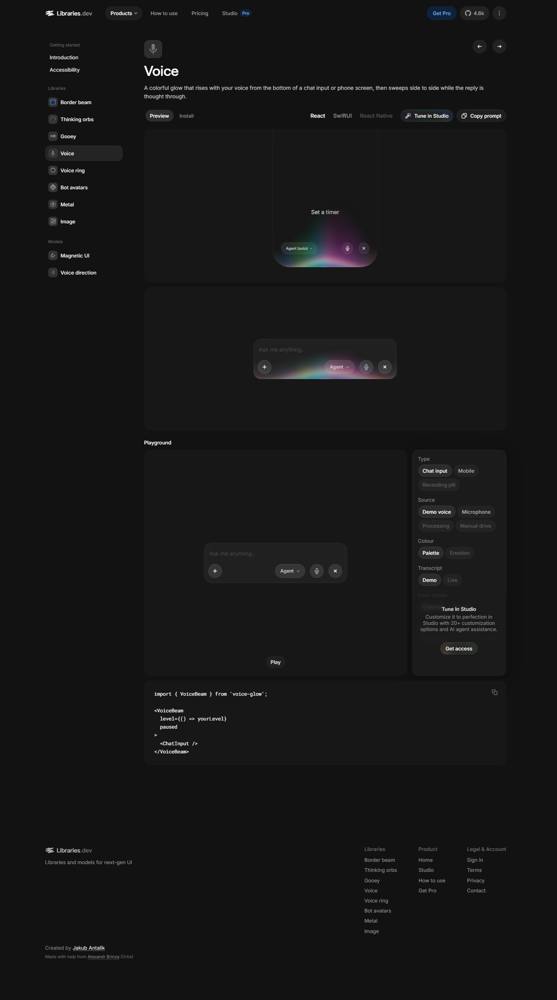

# Direção visual do experimento

Referência principal: https://libraries.dev/voice, capturada em 04/11/2026. Esta direção substitui a composição anterior do experimento, por pedido do usuário. O portal continua sendo uma aplicação React, com as mesmas rotas, dados e BFF.

## Evidência observada

Captura em `docs/references/libraries-voice.png`. Valores medidos pelo navegador e conferidos no CSS público do repositório MIT https://github.com/Jakubantalik/Libraries.dev.

- Container externo de 1240 px, com 24 px de margem interna.
- Cabeçalho de 68 px, menu lateral de 200 px, intervalo de 56 px para o conteúdo.
- Fundo escuro #121212; superfícies #181818; texto branco; texto secundário #a1a1a1.
- Título de 36 px, peso 500; corpo Inter; controles de 13 px, peso 500.
- Superfícies amplas com raio de 16 px. Botões compactos em cápsula e ícones de 36 px.
- Menu lateral sem uma caixa ao redor. Ícones em pequenos ladrilhos e item ativo com fundo elevado.
- Cabeçalho de conteúdo, seletor de modo, área interativa, grid de conteúdo e painel contextual.
- Em tela estreita, o menu lateral dá lugar à navegação móvel e o grid vira uma coluna.

## Adaptação ao portal

A marca e os textos são da Pitang. A tipografia usa Inter local; a fonte comercial Saans da referência não foi copiada. As cores semânticas de área, sucesso e links permanecem disponíveis. O tema claro mantém a mesma geometria e hierarquia. A preferência de tema salva é respeitada.

A página inicial usa o padrão de modos Explorar/Instalar. O modo Explorar contém a busca real e uma visualização local de microfone opcional. Instalar apresenta os comandos existentes. O menu global e os menus da documentação compartilham a geometria do site de referência, sem menus duplicados no mesmo nível.

## Recursos e limites

- `voice-glow`: componente oficial VoiceBeam e hook useMicrophone, ativado por gesto explícito. Sem gravação ou transcrição. Não simular envio a uma IA.
- Fluid Functionalism: algoritmo de seleção do destaque preservado e camada de destaque adaptada à navegação do portal. Licença em `src/components/fluid/LICENSE`.
- Motion: transições interrompíveis e estado imediato ao teclado. Morphicons: ícones de mudança de estado. Torph: rótulos de confirmação. NumberFlow: progresso real.
- DialKit: ajustes de desenvolvimento, com os valores padrão fixos em produção.
- Recursos pagos do Studio não fazem parte do código público e não são simulados.

Todo conteúdo interativo precisa de nome acessível, foco visível e comportamento de teclado. Movimento reduzido é respeitado. Não há animação contínua de entrada, efeitos decorativos sobre texto ou números de catálogo inventados.
