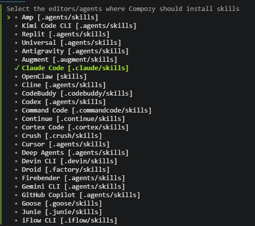
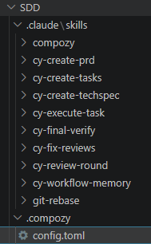

> **Contexto dos exemplos**
>
> Todos os exemplos deste guia se passam na Empresa Pitang, que é fictícia, e no domínio de negócio Gestão de Pedidos. Organização, sistema e domínio estão descaracterizados; a stack tecnológica é a real.

**COMECE AQUI**

## Duas formas de usar este guia {#como-usar}

Você não precisa ler tudo em ordem. Escolha a porta de entrada pelo seu objetivo. Cada uma das duas rotas se lê sozinha, e os links levam de uma à outra.

> 🔧 **Rota 1 · dev / tech lead**
>
> **Vou implantar agora**
>
> Vá direto ao [Manual de configuração (2.2)](#checklist) e siga os blocos na ordem. Cada bloco tem um **porquê ⤴** que te leva ao conceito na parte Como funciona na hora que a dúvida aparecer.

> 🧭 **Rota 2 · ver na prática**
>
> **Só quero ver funcionando**
>
> Vá à [seção 1.8](#jornada), que leva uma feature de exemplo pelo pipeline inteiro, do [PBI](#sigla) ao código revisado.

> 🏷️ Antes de copiar qualquer caminho: nomes como `Pitang.Pedidos.Api` e a stack (.NET, React…) são **exemplos**, e você troca pelos seus. Já `SDD/`, `.compozy/`, `.claude/`, `cy-*` e `compozy` são **estruturais** e não mudam. A legenda completa está no topo do [Manual 2.2](#checklist).


**COMO FUNCIONA**

## 1.1 O workspace: 4 repositórios {#workspace}

O [SDD](#sigla) não vive num repositório só. Um **workspace multi-repo** reúne, lado a lado na mesma pasta de trabalho, o repositório de **orquestração**, onde o processo roda, e os repositórios de **implementação**, onde o código mora. O orquestrador enxerga os outros como vizinhos (por paths relativos), lê as rules de cada um e escreve os artefatos do pipeline num lugar só. Assim, uma feature que toca backend, frontend e testes tem um plano só e um rastro só, e cada repositório mantém o seu padrão.

#### SDD/

Repositório de **orquestração**. Guarda o CLAUDE.md central, a pasta `Features/PBI<id>/` (fonte do [PBI](#sigla), com `feature.md` e materiais de apoio), as skills em `.claude/skills/` e os artefatos do pipeline em `.compozy/tasks/<slug>/` ([PRD](#sigla), [TechSpec](#sigla), tasks, [ADRs](#sigla), reviews, memory). É daqui que o Compozy conduz o fluxo do [PBI](#sigla) ao review.

Compozy · CLAUDE.md central · skills · artefatos

#### Pitang.Pedidos.Api

**Backend**: regras de negócio de pedidos e [API](#sigla) [REST](#sigla). Entidades, repositórios, serviços de negócio e validações.

.NET · EF Core · .claude/rules · CLAUDE.md

#### Pitang.Pedidos.Web

**Frontend**: telas de gestão de pedidos. Páginas, componentes, hooks de dados, formulários e validação.

React · Zod · .claude/rules · CLAUDE.md

#### Pitang.Pedidos.TestesAutomatizados

**Testes funcionais**: automação de ponta a ponta das telas. Features Gherkin, steps, drivers e page objects.

Reqnroll · Selenium · .claude/rules · CLAUDE.md

> 💡 **SDD/** é o cérebro do processo, e os três repositórios de implementação são os braços. **Todo repositório de código tem o seu próprio `CLAUDE.md`**, além do `.claude/rules/`. Isso não é opcional e não depende do tamanho nem da linguagem do repositório. É assim que o mesmo processo respeita padrões diferentes em cada camada.

> 🧭 Na prática, comece pelo **SDD/**. Não é exigência técnica: os paths relativos (`../Pitang.Pedidos.Api` etc.) resolvem em qualquer ordem de clone, desde que todos acabem lado a lado na mesma pasta de trabalho. Mas criar ou clonar o `SDD/` primeiro tem uma vantagem prática. É ali que você decide os nomes dos repositórios de implementação e a estrutura dos apontamentos de rules antes de clonar os outros, e assim o CLAUDE.md central já nasce coerente, sem ajuste depois. Os nomes `Pitang.Pedidos.*` e a stack aqui são exemplos; troque pelos seus. A legenda completa está no [Manual 2.2](#checklist).

[fazer ⤵ · 2.2 Bloco 1 · workspace](#checklist)

**COMO FUNCIONA**

## 1.2 CLAUDE.md central e por repositório {#claude-md}

O `CLAUDE.md` é o arquivo de instruções que o agente lê **automaticamente** ao abrir o workspace: as regras que ele obedece antes de qualquer tarefa. Há dois níveis. O **central**, na raiz do `SDD/`, rege o processo inteiro. O **por repositório** rege os padrões daquela base de código. Juntos, eles definem o idioma dos artefatos, de onde vem o pedido e quais regras valem em cada lugar.

#### O CLAUDE.md central: três papéis

> 🌐 **Papel 1**
>
> **Idioma dos artefatos**
>
> Fixa o pt-BR para todo o material que o pipeline gera ([PRDs](#sigla), [TechSpecs](#sigla), tasks, [ADRs](#sigla), reviews e memory), mas preserva as chaves e os valores que o Compozy espera na metadata.

> 📥 **Papel 2**
>
> **Fonte do [PBI](#sigla)**
>
> Aponta a pasta `Features/PBI<id>/` como a entrada de negócio padrão. Cada PBI tem a sua subpasta, com `feature.md` e materiais de apoio (protótipos, mockups, outros documentos). É o ponto de partida que o [PRD](#sigla) lê antes de qualquer brainstorming.

> 🧭 **Papel 3**
>
> **Apontamentos de rules**
>
> Manda o agente ler as rules do repositório-alvo antes de decidir arquitetura ou editar código. Cada repositório tem o seu conjunto, descrito na próxima seção.

SDD/CLAUDE.md · idioma dos artefatos

Gere todos os artefatos de planejamento e workflow do Compozy em português (pt-BR). Aplica-se a tudo sob `.compozy/tasks/`: [PRDs](#sigla), TechSpecs, listas de tasks, task files, [ADRs](#sigla), issues de review e notas de memory. Preserve as chaves de frontmatter e os valores de enum/status/type esperados pelo Compozy (por exemplo `pending`, `completed`, `backend`, `frontend`).

SDD/CLAUDE.md · fonte do Feature/[PBI](#sigla)

Use a pasta `Features/` na raiz do workspace [SDD](#sigla) como fonte padrão da descrição do Feature/[PBI](#sigla). Cada PBI tem sua subpasta `Features/PBI<id>/`, com `feature.md` mais materiais de apoio. Antes de criar ou atualizar um [PRD](#sigla), leia todo o conteúdo da pasta `Features/PBI<id>/` relevante e trate-o como a entrada de negócio autoritativa, salvo instrução explícita em contrário. Se houver mais de uma subpasta e nenhum id for citado, pergunte ao usuário qual PBI está sendo implementado.

SDD/CLAUDE.md · apontamentos de rules por repositório

Antes de criar/atualizar artefatos ou editar código, leia as rules do repositório-alvo:\
 • Backend: `../Pitang.Pedidos.Api/.claude/rules/*.md`\
 • Frontend: `../Pitang.Pedidos.Web/.claude/rules/*.md`\
 • Testes funcionais: `../Pitang.Pedidos.TestesAutomatizados/.claude/rules/*.md`

#### O CLAUDE.md por repositório

Cada repositório de implementação traz o seu próprio `CLAUDE.md`, com os princípios gerais daquela base de código e uma tabela que **roteia** para a rule de cada camada. Essa tabela é o índice que diz ao agente qual arquivo de regra carregar conforme o que ele está editando.

*Pitang.Pedidos.Web/CLAUDE.md · trecho*

```markdown
# Padrões de Código — Frontend Pitang.Pedidos.Web

Regras detalhadas por camada estão em .claude/rules/:

| Arquivo           | Quando é carregado automaticamente           |
|-------------------|----------------------------------------------|
| components.md     | Ao editar src/components/**                  |
| pages.md          | Ao editar src/pages/**                       |
| forms.md          | Ao editar *schema* ou *form* em src/pages/** |
| file-placement.md | Em qualquer arquivo do projeto               |
```

> 💡 Central x por repositório: o **central** rege o *processo* (idioma, [PBI](#sigla), para onde olhar); o **por repositório** rege o *código* (padrões e roteamento das rules). Um não duplica o outro; os dois se completam.

#### Template para o CLAUDE.md central do seu workspace

Um template de `CLAUDE.md` pronto para colar na raiz do seu workspace de orquestração. Os pontos que variam de time para time (idioma dos artefatos, pasta de features e lista de repositórios) vêm destacados para você preencher na configuração inicial.

[📋 Copiar template do CLAUDE.md central](#template-claude-md)

[fazer ⤵ · 2.2 Blocos 2 e 4 · CLAUDE.md](#checklist)

**COMO FUNCIONA**

## 1.3 Rules escopadas por path {#rules}

Se o CLAUDE.md é o padrão geral, as **rules** são o padrão de cada camada. Cada rule é um arquivo `.md` em `.claude/rules/` com um frontmatter que declara o seu **escopo por [glob](#sigla) de path**. Quando o arquivo que o agente vai editar casa com o [glob](#sigla), a rule entra no contexto **automaticamente**, sem ninguém pedir. É isso que faz uma mesma feature respeitar convenções diferentes de backend, frontend e testes sem misturar tudo num arquivo gigante.

> **Único formato reconhecido**
>
> **`paths`: lista de [globs](#sigla)**
>
> O único campo de frontmatter que o Claude Code reconhece em `.claude/rules/*.md` é `paths`: uma lista YAML de padrões [glob](#sigla). É o formato das rules dos três repositórios (backend, frontend e testes automatizados), sem exceção.

> **Sem paths**
>
> **A rule carrega sempre**
>
> Uma rule sem frontmatter `paths` entra no contexto em toda sessão, na mesma prioridade do `CLAUDE.md`. Reserve isso para o que vale para o repositório inteiro. O padrão é escopar.

> ⚠️ **O único campo de frontmatter que a rule reconhece é `paths`.** Não invente outras chaves. Um campo `description`, por exemplo, pertence às [skills (1.4)](#skills), que carregam por relevância semântica, um mecanismo diferente do das rules. Dentro de `.claude/rules/`, ele não tem efeito. O único gatilho de escopo automático é o [glob](#sigla) em `paths`.

> 💡 Os trechos de rules abaixo estão em **português para facilitar a leitura**. Nos repositórios reais, prefira escrevê-las em **inglês**: instruções em inglês tendem a consumir menos tokens e são o padrão mais testado nos modelos. O prompt gerador, no fim desta seção, deixa você escolher o idioma na hora de criar as suas.

#### Backend · Pitang.Pedidos.Api

*.claude/rules/business.md · trecho*

```markdown
---
paths:
  - "src/Pitang.Pedidos.Business/**/*.cs"
  - "src/Pitang.Pedidos.Business.Imp/**/*.cs"
---

# Instruções de Business

- Modele casos de uso como serviços de negócio: implementação `<Nome>Business` em
  `src/Pitang.Pedidos.Business.Imp/Business/<Dominio>/` e interface `I<Nome>Business`
  em `src/Pitang.Pedidos.Business/IBusiness/<Dominio>/`.
- Mantenha nomes de caso de uso e de domínio em português, preservando o sufixo técnico em
  inglês, como `PedidoBusiness`, `AprovacaoPedidoBusiness` e `IDetalhamentoPedidoBusiness`.
- A injeção de dependência é por convenção: `DependencyInjector.RegisterGenerico` registra toda
  classe terminada em `Business` como scoped contra a interface `I*Business` correspondente.
- Mantenha os serviços de negócio focados em orquestração, fluxo de validação e decisão de
  negócio; chame os repositórios pelas interfaces `I*Repository`.
- Mantenha detalhes de transporte (HTTP status codes, `IActionResult`, request binding) fora.
```

| Rule | Escopo (`paths`) | Cobre |
|---|---|---|
| `api.md` | `API/Controllers/**/*.cs` | Controllers e endpoints [REST](#sigla) |
| `business.md` | `Business/**`, `Business.Imp/**` | Serviços e interfaces de negócio |
| `entities.md` | `Entity/Entities/**`, `Repository.Imp/Mapping/**` | Entidades de domínio e mapeamentos [EF Core](#sigla) |
| `repository.md` | `Repository/**`, `Repository.Imp/**` | Repositórios [EF Core](#sigla), interfaces e transações |
| `dtos-validation.md` | `Entity/DTO/**`, `UnitTest/FluentValidation/**` | [DTOs](#sigla) e validadores FluentValidation |
| `tests.md` | `UnitTest/**`, `IntegrationTest/**` | Testes unitários e de integração |
| `file-placement.md` | `src/**/*.cs` | Onde cada arquivo C# deve ficar |

#### Frontend · Pitang.Pedidos.Web

*.claude/rules/forms.md · trecho*

```typescript
---
paths:
  - "src/pages/**/*schema*"
  - "src/pages/**/*form*"
---

# Padrões de Formulários e Validação Zod

## Regra 1 — customErrorMap em todo schema file
import { z } from 'zod';
import { customErrorMap } from '@/utils/validation-utils';

z.setErrorMap(customErrorMap);   // mensagens de erro em pt-BR, padrão único

## Regra 2 — discriminatedUnion para formulários com modos distintos
const novoSchema = z.object({
  modo: z.literal(ModoPedido.NOVO),
  codigoPedido: z.array(chaveDescricaoNumeroSchema).optional(),   // opcional no novo
});
const complementoSchema = z.object({
  modo: z.literal(ModoPedido.COMPLEMENTO),
  codigoPedido: z.array(chaveDescricaoNumeroSchema).min(1),       // obrigatório no complemento
});

export const formSchema = z.discriminatedUnion('modo', [novoSchema, complementoSchema]);
export type FormData = z.infer<typeof formSchema>;
```

| Rule | Escopo (`paths`) | Cobre |
|---|---|---|
| `components.md` | `src/components/**` | Componentes reutilizáveis e complexos |
| `pages.md` | `src/pages/**` | Páginas da aplicação |
| `hooks.md` | `src/hooks/**` | Hooks (useQuery/useMutation) |
| `services.md` | `src/core/services/**` | Services de [API](#sigla) |
| `models.md` | `src/models/**` | Tipos, interfaces e enums |
| `routes.md` | `src/routes/**` | Rotas (createHashRouter) |
| `styles.md` | `src/styles/**` | [CSS](#sigla) global, variáveis e Tailwind |
| `utils.md` | `src/utils/**` | Funções utilitárias e helpers |
| `ag-grid.md` | `column-defs-*.tsx`, `components/ag-grid/**`, `utils/ag-grid/**` | Grids ag-Grid |
| `forms.md` | `*schema*`, `*form*` em `src/pages/**` | Formulários e validação Zod |
| `tests.md` | `*.test.*`, `*.spec.*` | Testes de frontend |
| `file-placement.md` | `**` | Posicionamento de arquivos |

#### Testes · Pitang.Pedidos.TestesAutomatizados

*.claude/rules/features.md · trecho*

```markdown
---
paths:
  - "Pitang.Pedidos.Testes.Automatizados/Pitang.Pedidos.Testes.Automatizados/Features/**/*.feature"
---

# Instruções de Feature Files

- Escreva o Gherkin em português do Brasil (`Funcionalidade:`, `Contexto:`, `Cenário:`,
  `Dado`/`Quando`/`Então`); o `reqnroll.json` define `language.feature: pt-BR`.
- Mantenha um arquivo por funcionalidade e perfil:
  `Features/<Funcionalidade>/<Funcionalidade>_Perfil<X>.feature`,
  como `ConsultarPedidos_PerfilGestor.feature`.
- Nomeie os cenários como `HIST<NNNN> - CT<NNN> - <descrição>` (HIST = história de usuário, CT = caso de teste).
- Marque todo cenário com a tag do seu grupo (como `@grupo_gestor_pedidos`) e uma tag de
  suíte (`@smoke` ou `@regressao`).
- Reaproveite textos de step existentes e o step assembly `Pitang.Testes.Automatizados.Base`
  antes de escrever um step novo.
```

| Rule | Escopo (`paths`) | Cobre |
|---|---|---|
| `features.md` | `Features/**/*.feature` | Features Gherkin em pt-BR |
| `steps-drivers-pages.md` | `Steps/**`, `Drivers/**`, `Pages/**`, `Base/**` | Step bindings, drivers e page objects |
| `components-selectors.md` | `Components/**`, `Selectors/**` | Componentes de [UI](#sigla) e seletores reutilizáveis |
| `data-scripts.md` | `Scripts/**/*.sql`, `Hooks/**`, `Helpers/**`, `ResourcesTest/**` | Scripts [SQL](#sigla) de massa, hooks e config de teste |
| `file-placement.md` | `**` | Posicionamento de arquivos no repositório |

#### Onde seu projeto está?

Nem todo projeto começa do zero. O mesmo prompt abaixo primeiro **avalia o repositório** e então age conforme o estágio em que ele está:

> 🚧 **Não IA-ready**
>
> **Nada de IA ainda**
>
> Sem `CLAUDE.md` nem `.claude/rules`. O prompt **gera do zero**: investiga o código e escreve o padrão completo.

> 🔀 **Parcial / fora do padrão**
>
> **Já tem algo, de outra ferramenta ou fora do padrão**
>
> Instruções de Copilot (`.github/copilot-instructions.md`), Cursor (`.cursorrules`), Codex (`AGENTS.md`) ou Claude fora do padrão. O prompt **lê o que existe, preserva o conhecimento e adéqua** ao padrão (`paths`).

> ✅ **Já no padrão**
>
> **CLAUDE.md + rules com `paths`**
>
> Já está IA-ready. O prompt **não sobrescreve** nada e só aponta lacunas: camadas faltantes, [globs](#sigla) desatualizados ou rules que divergiram do código.

#### Deixe seu projeto IA-ready

Um único prompt para qualquer stack: React, Angular, .NET, Java, Python ou outra. Ele **investiga o repositório real**, avalia o que já existe e, conforme o caso, **gera** do zero o `CLAUDE.md` e as `.claude/rules/*.md` ou **adéqua** a estrutura atual ao padrão mostrado acima.

> 🧑‍💻 **O prompt gera a estrutura inicial, não a palavra final.** O **Tech Lead precisa revisar** o `CLAUDE.md` e as rules geradas e ajustar o que for preciso: nomes de camada, [globs](#sigla), convenções e regras específicas do projeto que a IA não tem como inferir sozinha. O prompt poupa o trabalho braçal; a revisão do Tech Lead garante que a estrutura reflita o padrão real do time.

[⚡ Gerar / adequar rules](#prompt-ia-ready)

[fazer ⤵ · 2.2 Bloco 3 · rules](#checklist)

**COMO FUNCIONA**

## 1.4 Skills do Compozy {#skills}

Uma **skill** empacota um procedimento reutilizável que o agente invoca quando o momento pede: o passo a passo de *como* conduzir cada fase. O Compozy traz **oito skills `cy-*`**, que automatizam o pipeline do [PBI](#sigla) ao review, e a **skill-manual `compozy`**, que é a referência de comandos e configuração. Elas ficam em `SDD/.claude/skills/` e são o motor do processo.

| Skill | Momento | Papel no pipeline |
|---|---|---|
| `cy-create-prd` | Planejamento | Cria o [PRD](#sigla) + o catálogo de histórias de usuário (`_user_stories.md`) por brainstorming interativo, com pesquisa paralela no código e na web. |
| `cy-create-techspec` | Planejamento | Traduz o [PRD](#sigla) em [TechSpec](#sigla) + o contrato de testes (`_tests.md`), com clarificação técnica interativa. |
| `cy-create-tasks` | Planejamento | Decompõe [PRD](#sigla) + TechSpec em task files independentes, atribuindo cada caso do `_tests.md` a uma task e enriquecendo com contexto do código. |
| `cy-execute-task` | Execução | Executa uma task de ponta a ponta: implementa, valida e reflete o resultado no tracking. |
| `cy-review-round` | Revisão | Revisa a implementação e gera uma rodada de review (issues) sem depender de provider externo. |
| `cy-fix-reviews` | Revisão | Remedia as issues de uma rodada (`reviews-NNN/`), aplica os fixes e verifica. |
| `cy-final-verify` | Transversal | Exige evidência de verificação fresca antes de declarar qualquer coisa concluída ou fazer commit. |
| `cy-workflow-memory` | Transversal | Mantém a memória de workflow por task em `.compozy/tasks/<name>/memory/`. |
| `compozy` | Manual | Skill-manual: referência de comandos, capacidades e configuração do Compozy. Não executa passos do pipeline. |

> ⚙️ **8 skills cy-\***
>
> **O motor do pipeline**
>
> Cada fase tem a sua skill. Encadeadas, elas levam a feature do [PBI](#sigla) ao review sempre pelos mesmos passos e pelos mesmos gates humanos. O processo vira algo que se executa, e não folclore de quem configurou.

> 📖 **Skill-manual**
>
> **`compozy`**
>
> Não conduz nenhuma fase. É a documentação viva do produto. A consulta de comandos, a estrutura de artefatos e a configuração do workspace ficam aqui, e por isso este guia apresenta a skill, mas não a substitui.

> 💡 Os nomes das skills **não são anonimizados**: `cy-create-prd` … `compozy` são do produto Compozy, não da organização. A anonimização cobre identidade (organização, sistema, domínio), não o ferramental.

[fazer ⤵ · 2.2 Bloco 5 · skills e setup](#checklist)

**COMO FUNCIONA**

## 1.5 Configuração: config.toml {#config}

O `.compozy/config.toml` é o arquivo que fixa os padrões do workspace: qual runtime de [IA](#sigla) usar, qual modelo, quanto esforço de raciocínio, como rodar as tasks e as revisões. Fica na raiz do repositório de orquestração (`SDD/.compozy/config.toml`) e vale para **todo comando do Compozy**, menos o que você sobrescrever por flag na linha de comando.

> ⚙️ **O `compozy setup` já gera esse arquivo.** Além de instalar as skills, o setup cria um `.compozy/config.toml` inicial no workspace, e você não precisa mais escrevê-lo do zero. O que continua com você é **revisar e ajustar** os padrões do time. Confira antes de tudo o **runtime**: se o `config.toml` não fixar `ide = "claude"`, o Compozy assume `codex` por padrão, e cada `compozy tasks run` sai no `codex` ou exige repetir `--ide claude` em todo comando.

#### Como ajustar

O `compozy setup` deixa um `.compozy/config.toml` pronto na raiz do workspace de orquestração, e o seu trabalho é abrir esse arquivo e ajustar os padrões. Comece pelo bloco `[defaults]` (runtime, modelo, esforço) e acrescente os outros blocos conforme precisar. Flags de [CLI](#sigla) sempre vencem o que está aqui, então o `config.toml` é a base, não uma amarra.

*SDD/.compozy/config.toml · o mínimo a conferir para rodar no Claude*

```toml
# Sem este bloco, o Compozy assume ide = "codex".
[defaults]
ide = "claude"              # runtime de IA: claude | codex | copilot | cursor-agent | gemini | droid | opencode | pi
model = "opus"              # modelo (cada ide tem o seu default; claude -> opus)
reasoning_effort = "high"   # low | medium | high | xhigh

# SDD/ é o workspace; add_dirs dá ao runtime acesso de leitura/escrita aos repos vizinhos
# (só claude e codex usam add_dirs). Sem isto, o agente não enxerga os repos de código.
add_dirs = ["../Pitang.Pedidos.Api", "../Pitang.Pedidos.Web", "../Pitang.Pedidos.TestesAutomatizados"]
```

#### O que dá para configurar

O arquivo se divide em blocos, e cada um afeta um comando (ou todos). Você só precisa dos blocos que quer ajustar. O que não estiver ali usa o default do Compozy.

| Bloco | Afeta | Configura |
|---|---|---|
| `[defaults]` | todos os comandos | runtime (`ide`), `model`, `reasoning_effort`, `auto_commit`, `max_retries`, `timeout`, `add_dirs` |
| `[tasks]` | `tasks validate` / `run` | os `types` válidos no frontmatter das `task_NN.md` (frontend, backend, docs…) |
| `[tasks.run]` + `[[tasks.run.task_runtime_rules]]` | `compozy tasks run` | overrides de runtime por **tipo** de task (ex.: backend no `sonnet`, docs em esforço menor) |
| `[fetch_reviews]` | `compozy reviews fetch` | provider externo de review (ex.: `coderabbit`) e nível de comentários |
| `[fix_reviews]` | `compozy reviews fix` | concorrência e tamanho de lote da remediação de issues |
| `[watch_reviews]` | `compozy reviews watch` | loop de revisão até limpar: rounds máximos, intervalo de polling, timeouts |
| `[exec]` | `compozy exec` | prompts avulsos: `verbose`, `tui`, `persist` |
| `[sound]` | `tasks run` / `exec` | notificação sonora quando um run termina (sucesso/falha) |

#### Exemplo mais completo, comentado

*SDD/.compozy/config.toml · com overrides por tipo de task*

```toml
[defaults]
ide = "claude"              # sem isto, o default seria "codex"
model = "opus"
reasoning_effort = "high"
auto_commit = false            # true = anexa instrução de commit ao fim de cada task/lote
max_retries = 2               # tentativas em caso de falha/inatividade (0 desliga)
timeout = "10m"               # timeout por run (formato de duração Go: 30s, 10m, 1h)
add_dirs = ["../Pitang.Pedidos.Api", "../Pitang.Pedidos.Web", "../Pitang.Pedidos.TestesAutomatizados"]

[tasks]
# Tipos válidos no frontmatter das task_NN.md — o cy-create-tasks valida contra esta lista.
types = ["frontend", "backend", "docs", "test", "infra", "refactor", "chore", "bugfix"]

# Override de runtime por TIPO de task, aplicado depois de [defaults].
[[tasks.run.task_runtime_rules]]
type = "backend"
model = "sonnet"             # backend no sonnet; os demais herdam opus de [defaults]

[[tasks.run.task_runtime_rules]]
type = "docs"
reasoning_effort = "medium"  # docs num esforço menor, para economizar

[fetch_reviews]
provider = "coderabbit"       # provider externo padrão do `compozy reviews fetch`

[sound]
enabled = true              # toca um som quando o run termina
on_completed = "glass"        # som de sucesso
on_failed = "basso"           # som de falha/cancelamento
```

> 💡 A ordem de precedência: **flag de CLI vence config, config vence default**. O `config.toml` define o comportamento padrão do workspace; um `--ide`, `--model` ou `--auto-commit` na linha de comando sobrescreve o config só naquele run. A referência completa de todos os campos está na skill-manual `compozy` ([1.4](#skills)).

[fazer ⤵ · 2.2 Bloco 5 · config.toml](#checklist)

**COMO FUNCIONA**

## 1.6 O pipeline Compozy {#pipeline}

Com o workspace configurado, o Compozy conduz cada feature por um **pipeline de fases em ordem**: cada fase consome o artefato da anterior e produz o seu. São **8 fases** do [PBI](#sigla) ao arquivamento (mais uma fase opcional de ideação) e **9 tipos de artefato** que registram o processo. Entre as fases há **gates de aprovação humana**: a [IA](#sigla) produz o artefato, e uma pessoa revisa e aprova antes de seguir. Nenhuma fase avança sozinha.

#### 1 Setup

`compozy setup` · sem gate · prep

Instala as skills `cy-*` e prepara o workspace. Roda **uma vez por projeto**. É a fundação apresentada na parte Como funciona, e não uma etapa de cada feature.

→ skills cy-\* + config

#### Ideação · opcional

`/cy-idea-factory` · opcional

Quando o pedido chega cru, expande a ideia num recorte pesquisado antes do [PRD](#sigla). O time aprova o enquadramento. Some quando o [PBI](#sigla) já vem claro.

→ \_idea.md

#### 2 PRD: o quê e por quê

`/cy-create-prd` · ✋ gate humano

Brainstorming do problema, do escopo e dos critérios de aceite. **Gate:** o dev aprova o *o quê* antes de ele virar design técnico, e aciona o [PO](#sigla) quando o escopo ou o aceite deixam dúvida.

→ \_prd.md · \_user\_stories.md · adrs/

#### 3 TechSpec: como

`/cy-create-techspec` · ✋ gate humano

Traduz o [PRD](#sigla) em arquitetura e decisões estruturais. **Gate:** o dev aprova a abordagem e os [ADRs](#sigla) antes de fatiar em tarefas, e aciona o tech lead em decisão estrutural.

→ \_techspec.md · \_tests.md · adrs/

#### 4 Tasks: o trabalho fatiado

`/cy-create-tasks` · ✋ gate humano

Decompõe [PRD](#sigla) + [TechSpec](#sigla) em task files independentes, enriquecidos com contexto do código. **Gate:** o dev aprova a decomposição e a ordem antes da execução.

→ \_tasks.md · task\_NN.md

#### 5 Execução: a IA implementa

`compozy tasks run` · ✋ gate humano

Cada task roda ponta a ponta (skill `cy-execute-task`, verificada por `cy-final-verify`) e atualiza a memória de workflow. **Gate:** o dev revisa o diff de cada task.

→ código · memory/

#### 6 Review: o pente-fino

`/cy-review-round` · ✋ gate humano

Revisão da implementação, manual (`/cy-review-round`) ou por um provider externo, que registra as issues em arquivos. **Gate:** o dev decide o que é issue válida.

→ reviews-NNN/

#### 7 Remediação: fechar as issues

`compozy reviews fix` · ↺ repete até limpo

Triagem, correção por severidade e verificação de cada issue. **Loop:** Review ⇄ Remediação se repete até a rodada ficar limpa; então segue para o arquivamento.

→ fixes + reviews-NNN/ resolvidas

#### 8 Archive: encerrar

`compozy archive` · ✋ gate humano

Depois do `compozy sync`, move o workflow concluído para `_archived/`. **Gate:** uma pessoa confirma que todas as tasks e reviews estão mesmo fechadas.

→ tasks/\_archived/

> 🧭 Como ler o trilho: logo abaixo do nome de cada fase vêm o **comando ou skill** que a dispara e o seu **gate**, e no fim, depois da seta (→), o **artefato** que ela produz. A Ideação é opcional; o **↺** marca o laço Review ⇄ Remediação, que repete até a revisão ficar limpa.

> 🔒 Os **9 artefatos** do processo (`_prd.md`, `_user_stories.md`, `_techspec.md`, `_tests.md`, `_tasks.md`, `task_NN.md`, `adrs/`, `reviews-NNN/` e `memory/`) moram em `.compozy/tasks/<slug>/` durante a feature e, no fim, vão para `tasks/_archived/` como histórico auditável. Eles guiam a geração e a revisão, e ninguém os mantém como documentação viva. Cada **✋** é um gate humano, e nenhum gate do processo é automático.

**COMO FUNCIONA**

## 1.7 O daemon e a interface web {#daemon}

As 8 fases da seção anterior não rodam no vácuo: todo `compozy tasks run` e todo `compozy exec` passam por um **daemon local**, o motor por baixo do pipeline. O mesmo daemon serve uma **interface web** em `http://localhost:2323`, onde você acompanha ao vivo cada run passando por aquelas fases. É a peça de **execução e observabilidade** do processo. Com ela, o que estava implícito nos comandos passa a ficar visível.

#### O que é o daemon

Um **processo em segundo plano**, do mesmo binário do Compozy, dono do estado dos runs, dos streams, dos snapshots e do catálogo `global.db` em `~/.compozy/`. Ele é **home-scoped**: existe **um só daemon por máquina**, que cuida de todos os workspaces, e não um por projeto. A [CLI](#sigla) o inicia sozinha quando um comando precisa dele, e você raramente pensa no daemon até querer observar ou diagnosticar um run.

#### O que o daemon administra

| Responsabilidade | O que guarda ou faz |
|---|---|
| Estado dos runs | O registro de tudo que já rodou e do que está rodando: status, modo (`task` ou `exec`), workflow e horários. |
| Streams ao vivo | Os eventos de um run conforme acontecem, empurrados para a interface em tempo real por [SSE](#sigla). |
| Transcript do agente | O passo a passo do que a [IA](#sigla) fez em cada fase de execução: as decisões, as edições e os comandos, não só o resultado final. |
| Snapshots | Uma fotografia do estado de um run num instante, para auditar ou depurar depois que ele termina. |
| Catálogo (`global.db`) | Os workspaces registrados na máquina, que alimentam a visão multi-workspace da interface. |
| [API](#sigla) + web UI | A porta `2323`, por onde a interface web (e qualquer integração sua) consome tudo o que está acima. |

#### Ciclo de vida do daemon

Três comandos cobrem o ciclo de vida, mas no dia a dia a [CLI](#sigla) cuida disso sozinha:

*ciclo de vida do daemon*

```bash
compozy daemon start     # sobe o daemon (ou deixe a CLI auto-iniciar quando precisar)
compozy daemon status    # estado, pid, http_port, runs ativos e nº de workspaces
compozy daemon stop      # encerra o daemon
```

O `status` mostra, entre outras coisas, a porta em que o daemon serve a interface web:

*compozy daemon status*

```text
state: ready
ready: true
http_port: 2323          # a interface web e a API ficam aqui
active_runs: 1
workspaces: 4            # home-scoped: todos os workspaces da máquina, não só o atual
```

#### A interface web em localhost:2323

Abra `http://localhost:2323` no navegador. É uma [SPA](#sigla) servida pelo próprio daemon, sem instalar nada além do Compozy, e funciona como painel de observabilidade dos runs. Ela tem quatro partes:

> 📊 **Painel de runs**
>
> **Tudo o que rodou e está rodando**
>
> Cada run com o seu **status** (rodando, concluído, falho), o modo (task ou exec), o workflow e os horários. A lista traz todos os runs, não só o atual.

> 📡 **Ao vivo**
>
> **Stream + transcript do agente**
>
> Acompanhe em tempo real o run em andamento e leia o **transcript completo** do que a [IA](#sigla) fez em cada passo. É a mesma execução da fase de código, agora visível.

> 🗂️ **Multi-workspace**
>
> **Todos os projetos numa visão só**
>
> Como o daemon é home-scoped, a interface reúne **todos os workspaces** registrados na máquina, e dá para pular de um projeto a outro sem trocar de terminal.

> 🔎 **Diagnóstico**
>
> **Eventos, snapshot e erros**
>
> Para cada run, os **eventos** do ciclo de vida, um snapshot do estado e a mensagem de erro quando algo falha. É o bastante para entender o que aconteceu sem caçar log.

#### No dia a dia

Como o daemon entra no fluxo de quem opera o pipeline, na prática:

1. Você dispara `compozy tasks run` (a fase de execução do pipeline) e a [CLI](#sigla) garante o daemon no ar.
2. Abre `localhost:2323` e acompanha o run **ao vivo**: o stream e o transcript mostram cada passo da [IA](#sigla).
3. Se algo falha, os **eventos** e a **mensagem de erro** daquele run dizem onde parou, sem você caçar log espalhado.
4. Depois, o **snapshot** fica como registro auditável do que aconteceu, útil na hora de revisar os gates.

> 🔒 **Local-first, e local mesmo.** O daemon é um único binário, sem plano de controle externo; o estado e o catálogo (`global.db`) ficam em `~/.compozy/`. A interface web e a [API](#sigla) expõem caminhos reais e dados dos seus runs. É uma ferramenta de operação na sua máquina, não algo para publicar ou expor na rede.

A feature da [próxima seção (1.8)](#jornada) roda inteira por este daemon: cada parada dela é um run que você poderia acompanhar aqui, ao vivo.

**COMO FUNCIONA**

## 1.8 Uma feature de ponta a ponta {#jornada}

Para tornar o pipeline concreto, uma feature fictícia passa por ele inteiro: **"Aprovação de pedidos acima de um limite de valor"** (slug `aprovacao-pedidos-limite`), na Empresa Pitang, domínio de Gestão de Pedidos. Cada parada abaixo é uma fase, com o que acontece nela, o **artefato** que sai dela e **quem aprova**.

#### 1 Ponto de partida: o [PBI](#sigla) chega

O workspace já está configurado (Setup feito: os 4 repositórios, o CLAUDE.md, as rules e as skills da parte Como funciona). A gestora pede uma regra nova: pedidos acima de um limite de valor precisam de aprovação manual antes de seguir. O solicitante escreve o [PBI](#sigla) em `feature.md`, a fonte de negócio do fluxo. Se a ideia viesse vaga, o time rodaria `/cy-idea-factory` antes para lapidá-la.

*SDD/feature.md · entrada do processo*

```markdown
# Aprovação de pedidos acima de um limite

Pedidos com valor total acima de um limite
configurável exigem aprovação de um gestor antes de
prosseguir. Abaixo do limite, o fluxo segue normal.
```

✋ **Quem aprova:** o [PO](#sigla)/solicitante define a intenção no `feature.md`, a única fonte de negócio que alimenta o [PRD](#sigla).

#### 2 Fase [PRD](#sigla): o quê e por quê

Com o `feature.md` como insumo, `/cy-create-prd` conduz um brainstorming (com pesquisa paralela no código e no mercado) e gera o `_prd.md` (problema, objetivos e critérios de aceite) e o catálogo `_user_stories.md` (histórias de usuário e casos de borda), mais um [ADR](#sigla) se houver decisão de produto. Nenhuma linha de código ainda.

*.compozy/tasks/aprovacao-pedidos-limite/\_prd.md*

```markdown
## Critério de aceite
- Pedido acima do limite fica "Aguardando aprovação".
- Só o perfil Gestor aprova; o cliente não avança sozinho.
- Abaixo do limite, nada muda no fluxo atual.
```

✋ **Quem aprova:** o dev revisa problema, escopo e critérios, e aciona o [PO](#sigla) quando o escopo ou o aceite deixam dúvida. Só depois do aceite o [PRD](#sigla) vira design técnico.

#### 3 Fase TechSpec: como

`/cy-create-techspec` lê o `_prd.md`, explora a arquitetura dos repositórios e produz o `_techspec.md` com as decisões estruturais e os [ADRs](#sigla): onde entra a validação do limite, o endpoint de aprovação, a tela no frontend e o teste funcional que cobre a regra. Junto sai o contrato de testes `_tests.md`, o catálogo de casos de teste da regra.

*\_techspec.md · decisões (ADR)*

```markdown
## Decisões
- Limite configurável em LimiteAprovacao (backend).
- Validação em PedidoBusiness marca RequerAprovacao.
- Web: badge "Aguardando aprovação" + ação Aprovar.
```

✋ **Quem aprova:** o dev aprova a abordagem e os [ADRs](#sigla). Decisão estrutural aciona o tech lead e passa com rigor; o resto passa leve.

#### 4 Fase Tasks: o trabalho fatiado

`/cy-create-tasks` decompõe [PRD](#sigla) + [TechSpec](#sigla) em task files independentes, enriquecidos com o padrão de cada repositório, monta o `_tasks.md` e atribui cada caso do `_tests.md` a uma task. A feature vira tarefas ordenadas por dependência, uma por camada.

*\_tasks.md · decomposição (task\_NN.md)*

```markdown
# | Tarefa                              | Tipo     | Dep
01 | Limite + validação no PedidoBusiness | backend  | —
02 | Endpoint de aprovação do pedido      | backend  | 01
03 | Tela de aprovação (badge + ação)     | frontend | 02
04 | Teste funcional da regra do limite   | test     | 03
```

✋ **Quem aprova:** o dev revê a decomposição e a ordem antes de qualquer execução.

#### 5 Fase Execução: a [IA](#sigla) implementa

`compozy tasks run aprovacao-pedidos-limite` despacha as tasks em ordem. Cada uma roda com a skill `cy-execute-task`, é verificada por `cy-final-verify` e registra decisões na `memory/`. O código sai pronto para revisão, uma task por vez.

*task\_01 · PedidoBusiness (trecho)*

```csharp
// Acima do limite: exige aprovação do gestor
if (pedido.ValorTotal > limite.Valor)
    pedido.RequerAprovacao = true;
```

✋ **Quem aprova:** o dev revisor confere o diff de cada task contra a spec. O rigor do gate é proporcional ao risco da mudança.

#### 6 Fase Review: o pente-fino

Com a implementação pronta, `/cy-review-round` faz uma revisão completa e registra os achados como issues em `reviews-NNN/` (ou `compozy reviews fetch` traz os comentários de um provider externo). Cada issue é um arquivo com metadados no frontmatter.

*reviews-001/issue\_001.md*

```markdown
---
status: pending
severity: major
file: PedidoBusiness.cs
---
Limite relido a cada chamada; avaliar cache do
LimiteAprovacao por requisição.
```

✋ **Quem aprova:** o dev revisor decide o que é issue válida e o que é ruído. A triagem é humana.

#### 7 Fase Remediação: fechar as issues

`compozy reviews fix aprovacao-pedidos-limite` processa a rodada: tria cada issue (válida/inválida), aplica o fix por severidade e verifica. O frontmatter caminha de `pending` → `valid` → `resolved`. Review ⇄ Remediação se repete até a rodada ficar limpa.

*issue\_001.md · status atualizado*

```diff
- status: pending
+ status: resolved   # cache aplicado e verificado
```

✋ **Quem aprova:** o dev confere os fixes e só encerra a rodada quando a revisão está limpa. Quem fecha o laço é uma pessoa.

#### 8 Fase Archive: encerrar

Com as tasks concluídas e as reviews resolvidas, `compozy sync` reconcilia o estado e `compozy archive --name aprovacao-pedidos-limite` move o workflow para `_archived/`. A feature está entregue, com rastro auditável do [PBI](#sigla) ao código.

*arquivamento do workflow*

```text
.compozy/tasks/aprovacao-pedidos-limite/
   → tasks/_archived/<timestamp>-aprovacao-pedidos-limite/
```

✋ **Quem aprova:** uma pessoa confirma que tudo fechou antes de arquivar. O encerramento também tem gate.

> 🧭 Oito paradas, oito fases: do `feature.md` ao `_archived/`, cada artefato teve um dono que aprovou antes de seguir. É uma feature só, `aprovacao-pedidos-limite`, passando por todo o trilho da seção anterior. Quem ler só esta seção entende o fluxo e o que cada fase produz.

> **Como adotar, em resumo**
>
> Este é o ato da **adoção**, voltado a quem vai colocar o processo de pé. Ele traz o **plano em 4 fases** para levar o [SDD](#sigla) à rotina do time, o **manual de configuração** para repetir num workspace novo a fundação que sustentou o caso da Empresa Pitang, e o **estado atual** desse caso: o que já está pronto e o que falta. No fim do ato, um tech lead consegue montar um workspace [SDD](#sigla) do zero seguindo só este material.

**COMO ADOTAR**

## 2.1 Plano de adoção {#adocao}

Adotar o [SDD](#sigla) não é ligar uma chave. São **quatro fases** em sequência: apresentar e alinhar, configurar o workspace, rodar um piloto real e, então, operar como rotina. Cada fase abaixo traz as **atividades**, os **responsáveis** e um **critério de saída** objetivo, e a fase só termina quando esse critério é cumprido.

#### 1 Apresentação e alinhamento

Levar o time e a gestão ao mesmo entendimento antes de mexer em qualquer arquivo.

**Atividades**

- Apresentar o guia na ordem dos três atos (valor → processo → adoção), projetado na reunião.
- Alinhar o novo papel do dev (**revisor/orquestrador**) e os gates humanos de cada fase.
- Responder dúvidas e registrar objeções e riscos percebidos pelo time.

**Responsáveis**

Apresentador / autor do material · Gestão / coordenação · Tech leads · Devs dos 3 times

****

🏁 **Critério de saída:** gestão e time descrevem o fluxo de fases e artefatos com as próprias palavras, e há decisão explícita de adotar o processo.

#### 2 Configuração do workspace

Montar a fundação seguindo o manual da próxima seção, do zero ao pipeline pronto para rodar.

**Atividades**

- Executar o [manual de configuração (2.2)](#checklist) bloco a bloco, na ordem.
- Montar a estrutura de repositórios, o CLAUDE.md e as rules por repositório, o CLAUDE.md central e as skills.
- Rodar `compozy setup` (que já gera o `.compozy/config.toml`) e revisar/ajustar os padrões do time.

**Responsáveis**

Tech lead · Dev de referência (monta a fundação)

****

🏁 **Critério de saída:** todos os blocos do checklist 2.2 marcados e `compozy setup` concluído. O workspace já executa o pipeline de ponta a ponta.

#### 3 Piloto com uma feature real

Atravessar o pipeline uma vez, com uma feature de verdade, exercitando cada gate humano.

**Atividades**

- Escolher uma feature de **baixo risco** e escrever o `feature.md`.
- Rodar o fluxo completo: [PRD → TechSpec → Tasks → Execução → Review → Archive (1.6)](#pipeline).
- Exercitar de verdade cada gate de aprovação humana ao longo do caminho.

**Responsáveis**

Dev (aprova os gates) · PO / solicitante (escreve o PBI) · Tech lead (decisões estruturais) · Devs revisores (execução/review)

****

🏁 **Critério de saída:** uma feature entregue ponta a ponta pelo processo, com rastro auditável do [PBI](#sigla) ao código e todos os gates aplicados de verdade.

#### 4 Operação e rotina

Tornar o [SDD](#sigla) o fluxo padrão das novas features e manter a fundação viva.

**Atividades**

- Adotar o pipeline como caminho padrão de toda nova feature.
- Refinar rules e CLAUDE.md conforme os padrões de código evoluem.
- Definir o **dono do material** e o gatilho de atualização; transformar dúvidas recorrentes em [FAQ](#sigla)/seções.

**Responsáveis**

Todo o time · Tech lead (curadoria das rules) · Dono do material

****

🏁 **Critério de saída:** novas features entram pelo pipeline por padrão, o time mantém a fundação atualizada e o onboarding de novos integrantes já usa o guia.

> 🧭 As fases são **sequenciais**, mas os critérios de saída são o que importa: não avance sem cumprir o da fase atual. A Fase 2 se apoia no manual da próxima seção; a Fase 3 usa o pipeline da parte Como funciona numa feature real de baixo risco.

**COMO ADOTAR**

## 2.2 Manual de configuração {#checklist}

É este manual que você segue para replicar o workspace: um **Bloco 0 de pré-requisitos** (instalar o CLI) e depois os **cinco blocos** que transformam uma pasta vazia num workspace [SDD](#sigla) funcionando. Trabalhe **na ordem**, porque cada bloco depende do anterior. Cada item descreve um **estado verificável** ("existe / criado / configurado"), e no fim você consegue dizer, item a item, se está feito. O botão porquê ⤴ de cada bloco leva à seção de Como funciona que explica por que aquele bloco existe.

#### Antes de começar: o que é literal e o que você adapta

Todos os exemplos usam a Empresa Pitang e uma stack .NET/React, mas o modelo vale para qualquer linguagem. Ao seguir os blocos, distinga o que é **convenção do Compozy** (fixo) do que é **exemplo de stack** (você troca pelo seu).

> 🔒 **Estrutural · mantenha assim**
>
> **Convenção do Compozy**
>
> `SDD/`, `.compozy/`, `.compozy/tasks/`, `.claude/rules/`, `.claude/skills/`, `Features/PBI<id>/`, `feature.md`, `config.toml`, `CLAUDE.md`, as skills `cy-*` e o comando `compozy`. São nomes de convenção do produto, e renomear quebra o pipeline.

> 🏷️ **Exemplo · adapte ao seu projeto**
>
> **Nomes e stack de exemplo**
>
> `Pitang.Pedidos.Api`, `.Web` e `.TestesAutomatizados` são nomes de exemplo para os seus repos de backend, frontend e testes; use os seus. A stack (.NET, React, Reqnroll…) é ilustrativa. Os nomes de rules por camada (`api.md`, `components.md`, `features.md`…) também são exemplos: crie as rules das camadas que o *seu* projeto tem.

> 🧩 **Mono-repo ou estrutura diferente?** O `SDD/` pode ser uma subpasta ou um repositório à parte. O que importa é que os caminhos até o código resolvam a partir dele (por `add_dirs` no [config.toml (1.5)](#config) ou por paths relativos). O número de repositórios também é decisão sua: um, três ou mais.

#### 0 Pré-requisitos e instalação do CLI

[porquê ⤴ · 1.7 O daemon](#daemon)

O binário `compozy` é o motor de tudo. É ele que instala as skills, roda o pipeline e sobe o daemon. Antes de qualquer outro bloco, o CLI precisa estar instalado e resolvendo no [PATH](#sigla).

- **Node.js** (versão [LTS](#sigla) recente) e `npm` disponíveis no [PATH](#sigla), porque o CLI é distribuído como o pacote npm `@compozy/cli` (`node --version` e `npm --version` respondem).
- O CLI está instalado **globalmente** com `npm install -g @compozy/cli`, e o executável se chama `compozy`.
- `compozy --version` responde com a versão instalada, o que confirma que o binário está instalado e **resolve no [PATH](#sigla)**.
- Fluxo de atualização conhecido: `compozy upgrade` traz o CLI para o último release. Rode quando o próprio CLI avisar *"Update available"* no fim de um comando.
- Na primeira execução, o **daemon home-scoped** sobe sozinho (ou com `compozy daemon start`), e um único daemon por usuário serve todos os workspaces. [porquê ⤴ · 1.7 O daemon](#daemon)

#### 1 Estrutura do workspace e repositórios

[porquê ⤴ · 1.1 O workspace](#workspace)

A base física: os repositórios lado a lado numa mesma pasta de trabalho, para que os paths relativos entre eles resolvam.

- Existe uma **pasta de trabalho única** contendo, lado a lado, o repositório de orquestração `SDD/` e os de implementação.
- Os três repositórios de implementação estão clonados como vizinhos de `SDD/`: `Pitang.Pedidos.Api` (backend), `Pitang.Pedidos.Web` (frontend) e `Pitang.Pedidos.TestesAutomatizados` (testes).
- A partir de `SDD/`, os paths relativos `../Pitang.Pedidos.Api`, `../Pitang.Pedidos.Web` e `../Pitang.Pedidos.TestesAutomatizados` resolvem para os repositórios corretos.
- Dentro de `SDD/` existe a pasta `.compozy/tasks/`, que receberá os artefatos do pipeline por feature.
- Dentro de `SDD/` existe a pasta `.claude/skills/`, onde as skills serão instaladas (bloco 5).

#### 2 CLAUDE.md por repositório

[porquê ⤴ · 1.2 CLAUDE.md](#claude-md)

O arquivo de instruções de cada base de código, com os princípios daquele repositório e a tabela que roteia para a rule de cada camada. **Todo repositório de código recebe um**, e isso não é opcional para nenhuma camada.

- Cada repositório de implementação (backend, frontend e testes) tem o seu `CLAUDE.md`, com os princípios daquela base e a tabela que roteia cada rule por camada.

#### 3 Rules escopadas por repositório

[porquê ⤴ · 1.3 Rules](#rules)

O padrão de cada camada, em arquivos que entram no contexto automaticamente conforme o [glob](#sigla) de path do arquivo que está sendo editado.

- Cada repositório de implementação tem a pasta `.claude/rules/` criada.
- Cada repositório (backend, frontend e testes) tem uma rule por camada com frontmatter `paths`. A lista completa de arquivos por repo está na [seção 1.3](#rules).
- Cada rule declara o seu **escopo por [glob](#sigla)** em `paths` (uma lista YAML) e entra no contexto automaticamente quando o agente edita o arquivo correspondente. Rule sem `paths` carrega sempre.
- Nenhuma rule tem campo `description`. Esse campo não existe na convenção de `.claude/rules/` e é exclusivo das [skills (bloco 5)](#skills).

#### 4 CLAUDE.md central

[porquê ⤴ · 1.2 CLAUDE.md](#claude-md)

O arquivo de instruções da raiz de `SDD/`, que rege o processo inteiro: idioma, fonte do [PBI](#sigla) e para onde olhar em cada repositório. Vem por último porque aponta para as rules dos blocos anteriores, e os repositórios já precisam estar **IA-ready** para o apontamento fazer sentido.

- Existe o arquivo `SDD/CLAUDE.md` na raiz do repositório de orquestração.
- Está configurado para **fixar o idioma pt-BR** de todos os artefatos gerados sob `.compozy/tasks/`, preservando as chaves e os valores de frontmatter esperados pelo Compozy (`pending`, `completed`, `backend`, `frontend`…).
- Aponta a pasta `Features/PBI<id>/` como **fonte padrão do [PBI](#sigla)** (`feature.md` + materiais de apoio) lida antes de qualquer [PRD](#sigla).
- Lista os **caminhos das rules** de cada repositório-alvo, que o agente lê antes de decidir arquitetura ou editar código (`../Pitang.Pedidos.Api/.claude/rules/*.md`, e os equivalentes para Web e TestesAutomatizados). Só faz sentido apontar para lá depois que os blocos 2 e 3 criaram esses arquivos.

#### 5 Skills e setup do Compozy

[porquê ⤴ · 1.4 Skills](#skills)

O motor do processo: as skills que conduzem cada fase e o arquivo de configuração que define os padrões de execução do workspace.

- `compozy setup` rodou em `SDD/` e instalou as **8 skills `cy-*`** em `.claude/skills/` (`cy-create-prd` … `cy-workflow-memory`).
- A **skill-manual `compozy`** está disponível como referência de comandos e configuração.
- O `.compozy/config.toml` gerado pelo `compozy setup` foi **revisado e ajustado**, com `[defaults]` definindo **`ide = "claude"`**. Sem isso, o Compozy roda no `codex` por padrão. [porquê ⤴ · 1.5 config.toml](#config)
- A seção `[tasks]` registra os `types` de task usados pelo time (`backend`, `frontend`, `docs`, `test`…).
- Quando aplicável, `[[tasks.run.task_runtime_rules]]` está configurado para ajustar o runtime por tipo de task.

> ✅ Manual completo = workspace pronto: com o **Bloco 0** e os **cinco blocos** marcados, a fundação de Como funciona está de pé e o pipeline já roda a primeira feature. Se um item não puder ser marcado, volte ao porquê ⤴ do bloco em Como funciona antes de seguir.

#### Passo a passo ilustrado: `compozy setup`

Com o CLI já instalado (Bloco 0), rode `compozy setup` na raiz do `SDD/`. O assistente é interativo, e os passos abaixo mostram o fluxo, do comando à estrutura final gerada no workspace.

1 · Rodar o setup e deixar todas as skills marcadas

*compozy setup · seleção de skills*

```powershell
PS C:\...\SDD> compozy setup

COMPOZY // SETUP
Install core and enabled extension assets plus scoped reusable agents

Setup Skills — selecione as skills a instalar (deixe todas marcadas):
 > ✓ compozy             manual do produto (comandos, artefatos, config)
   ✓ cy-create-prd        cria o PRD + catálogo de histórias
   ✓ cy-create-tasks      decompõe PRD/TechSpec em tasks
   ✓ cy-create-techspec   cria a TechSpec + contrato de testes
   ✓ cy-execute-task      executa uma task do PRD ponta a ponta
   ✓ cy-final-verify      exige evidência de verificação antes de concluir
   ✓ cy-fix-reviews       remedia issues de review de PR
   ✓ cy-review-round      faz o review completo de uma implementação
   ✓ cy-workflow-memory   mantém a memória de contexto entre tasks
   ✓ git-rebase           (extensão) resolve conflitos de merge/rebase
 x alterna · ↑ cima · ↓ baixo · / filtrar · enter confirmar
```

2 · Escolher o editor/agent onde instalar as skills

Selecione o editor da sua preferência. No caso deste guia, **Claude Code** (`.claude/skills`).



*Lista de editores suportados; a marcação em `Claude Code [.claude/skills]` instala as skills nesse agente.*

3 · Escopo: usar `Project` (recomendado)

*escopo de instalação*

```powershell
Choose whether skills and reusable agents are shared per project or available globally
 > Project (recomendado)
   Global
```

`Project` instala no próprio workspace (`SDD/.claude/skills/`), e não no perfil global do usuário. É isso que mantém a fundação versionada junto do repositório.

4 · Salvar os defaults do workspace (gera o `config.toml`)

*geração do config.toml*

```powershell
Save workspace defaults to C:\...\SDD\.compozy\config.toml.
 [ Yes ]   No
```

Responda **Yes**: é neste passo que o `compozy setup` **gera o `.compozy/config.toml`** com os padrões do workspace. A seção [1.5](#config) diz o que ajustar depois.

5 · Conferir o resumo e confirmar a instalação

*Installation Summary*

```powershell
Installation Summary
  Scope      project
  Method     copy
  Config     .\.compozy\config.toml [update]
  Defaults   claude / opus / high

  compozy             -> Claude Code   .\.claude\skills\compozy
  cy-create-prd       -> Claude Code   .\.claude\skills\cy-create-prd
  cy-create-tasks     -> Claude Code   .\.claude\skills\cy-create-tasks
  cy-create-techspec  -> Claude Code   .\.claude\skills\cy-create-techspec
  cy-execute-task     -> Claude Code   .\.claude\skills\cy-execute-task
  cy-final-verify     -> Claude Code   .\.claude\skills\cy-final-verify
  cy-fix-reviews      -> Claude Code   .\.claude\skills\cy-fix-reviews
  cy-review-round     -> Claude Code   .\.claude\skills\cy-review-round
  cy-workflow-memory  -> Claude Code   .\.claude\skills\cy-workflow-memory
  git-rebase          -> Claude Code   .\.claude\skills\git-rebase

Proceed with installation?   [ Yes ]   No
```

Os **Defaults `claude / opus / high`** confirmam o runtime no Claude. Confirme com **Yes** para concluir a instalação.

6 · Estrutura gerada ao final



*`.claude/skills/` com as skills instaladas (`compozy`, `cy-*`, `git-rebase`) e `.compozy/config.toml`: a fundação pronta do workspace.*

**COMO ADOTAR**

## 2.3 Estado atual e próximos passos {#proximos-passos}

Para tornar o plano concreto, este é o retrato do caso da Empresa Pitang, domínio de Gestão de Pedidos. A **fundação está pronta**: os blocos 1 a 4 do manual e a instalação das skills, o que fecha a Fase 2. O que falta são os itens que dependem da **primeira feature real** (Fase 3, o piloto). Cada linha abaixo mostra o estado: feito ou pendente.

#### Fundação pronta

- [x] **Workspace com os 4 repositórios** lado a lado: `SDD/` e os três de implementação, com paths relativos resolvendo. · **Feito**
- [x] **CLAUDE.md por repositório** nos três repositórios de implementação, cada um com princípios e o roteamento das suas rules. · **Feito**
- [x] **Rules escopadas por path** nos três repositórios de implementação (backend, frontend e testes), cada uma com o seu [glob](#sigla). · **Feito**
- [x] **CLAUDE.md central** configurado com idioma pt-BR, `Features/PBI<id>/` como fonte do [PBI](#sigla) e apontamentos das rules por repositório. · **Feito**
- [x] **8 skills `cy-*` + skill-manual `compozy`** instaladas em `.claude/skills/` via `compozy setup`. · **Feito**

#### Próximos passos

- [ ] **`feature.md` da primeira feature real** preenchido. É o [PBI](#sigla) que abre o pipeline, e ainda não foi escrito. · **Pendente**
- [ ] **`.compozy/config.toml` afinado** para o time, com `ide`, `model`, `reasoning_effort` e os `types` de task ajustados. · **Pendente**
- [ ] **Piloto ponta a ponta**: rodar uma feature pelo fluxo completo ([PRD](#sigla) → [TechSpec](#sigla) → Tasks → Execução → Review → Archive), exercitando cada gate. É a Fase 3 do plano. · **Pendente**

> 🚀 O caminho é curto. Com a fundação de pé, o próximo passo é escolher uma feature de baixo risco, escrever o `feature.md` e disparar o [pipeline (1.6)](#pipeline). A feature de exemplo `aprovacao-pedidos-limite`, na [seção 1.8](#jornada), mostra como esse piloto se desenrola.

**PERGUNTAS FREQUENTES**

## ? Dúvidas comuns {#faq}

As perguntas que mais aparecem ao adotar o [SDD](#sigla) com Compozy.

#### 01 Preciso ser programador para adotar o SDD?

O [SDD](#sigla) não elimina o dev, mas muda o papel dele. Em vez de digitar cada linha, o desenvolvedor passa a **revisar, questionar e aprovar** o que a [IA](#sigla) produz em cada gate. É esse olhar técnico e crítico que garante que a spec e o código estejam corretos. Veja [Governança](/metodo/por-que-utilizar-o-sdd#governanca).

#### 02 O Compozy substitui o desenvolvedor?

Não. A [IA](#sigla) gera os artefatos e o código, mas **nenhuma fase avança sem aprovação humana**. O dev continua responsável pela decisão técnica; o Compozy só torna o processo executável e rastreável.

#### 03 Funciona com a minha stack, mesmo não sendo .NET/React?

Sim. A stack dos exemplos (.NET, React, Reqnroll) é ilustrativa, e o modelo vale para qualquer linguagem. O que é **estrutural** (`SDD/`, `.compozy/`, `.claude/`, `cy-*`, `compozy`) não muda; os nomes de repositório e as rules por camada você adapta ao seu projeto. Veja a legenda no [Manual 2.2](#checklist).

#### 04 E se eu tenho um mono-repo ou um número diferente de repositórios?

Funciona. O `SDD/` pode ser uma subpasta ou um repositório à parte. O que importa é que os caminhos até o código resolvam a partir dele (por `add_dirs` no [config.toml (1.5)](#config) ou por paths relativos). Um, três ou mais repositórios: a escolha é sua.

#### 05 Quais runtimes de IA o Compozy suporta?

`claude`, `codex`, `copilot`, `cursor-agent`, `gemini`, `droid`, `opencode` e `pi`. Você fixa o padrão no `config.toml` (`ide = "..."`) e pode sobrescrever por comando com `--ide`. Veja [Configuração (1.5)](#config).

#### 06 Como instalo e por onde começo?

Instale o [CLI](#sigla) (`npm install -g @compozy/cli`), rode `compozy setup` na raiz do `SDD/` para instalar as skills e gerar o `config.toml`, e siga o [Manual de configuração (2.2)](#checklist) bloco a bloco. Depois escolha uma feature de baixo risco para o piloto.

#### 07 O compozy setup sobrescreve o que eu já tenho?

O setup mostra um **resumo (Installation Summary) e pede confirmação** antes de aplicar. Ele instala ou atualiza as skills `cy-*` e gera o `config.toml` inicial, e você revisa e ajusta os padrões do time depois. O passo a passo ilustrado está no [Manual 2.2](#checklist).

#### 08 Onde ficam os artefatos? Eles vão para o Git?

Todos moram em `.compozy/tasks/<slug>/`, versionados junto do código. Ao fim da feature, o workflow vai para `tasks/_archived/` como histórico auditável. São **9 artefatos** (do `_prd.md` às `reviews-NNN/`), listados no [pipeline (1.6)](#pipeline).

#### 09 Preciso manter as specs como documentação viva?

Não. [PRD](#sigla), [TechSpec](#sigla) e tasks **guiam a geração e a revisão** e viram histórico auditável. Não são documentação que você precise manter sincronizada para sempre.

#### 10 Posso pular o PRD/TechSpec e ir direto ao código?

Dá, mas é justamente isso que o [SDD](#sigla) evita. Sem a spec aprovada, você volta ao **"vibe coding"**: deriva de intenção, requisitos adivinhados e retrabalho. Os gates existem para pegar isso cedo. Veja [O problema](/metodo/por-que-utilizar-o-sdd#problema).

#### 11 O que são os gates humanos? Posso desligá-los?

São os pontos de aprovação entre as fases: a [IA](#sigla) produz, e uma pessoa revisa e aprova antes de seguir. O rigor de cada gate é **proporcional ao risco**, mas nenhum deve ser pulado, porque são eles que separam velocidade de dívida. Veja [Governança](/metodo/por-que-utilizar-o-sdd#governanca).

#### 12 Isso não fica caro em tokens?

O [SDD](#sigla) investe mais no planejamento (barato) para cortar retrabalho (caro), que é a lógica da **regra 90/10**. Você também pode usar modelos mais baratos por tipo de task e validação focada (Fast Mode). Veja [Métricas](/metodo/por-que-utilizar-o-sdd#metricas).

#### 13 Preciso de internet? Meus dados vão para algum lugar?

O motor é um **daemon local**, local-first, sem plano de controle externo. Ele sobe sozinho quando preciso e serve a interface web na sua própria máquina. As chamadas ao modelo de IA, claro, dependem do provedor que você configurar. Veja [Daemon (1.7)](#daemon).

#### 14 Como atualizo o Compozy?

`compozy upgrade` traz o [CLI](#sigla) para o último release. O próprio CLI avisa *"Update available"* no fim de um comando quando há versão nova.

#### 15 Serve para bugs pequenos ou só para features grandes?

Serve para os dois, porque os gates são **proporcionais ao risco**. Uma mudança trivial passa leve; uma decisão estrutural passa com rigor e aciona o tech lead. Veja [Governança](/metodo/por-que-utilizar-o-sdd#governanca).

#### 16 Já tenho CLAUDE.md/rules de outra ferramenta. Preciso recomeçar?

Não. Há um prompt **"IA-ready"** que investiga o repositório real, aproveita o que já existe e gera ou adéqua o `CLAUDE.md` e as rules ao padrão `paths`. Depois, o **Tech Lead revisa e ajusta** o resultado. Veja [Rules (1.3)](#rules).

#### 17 Posso usar modelos diferentes por tipo de task?

Sim. No `config.toml`, `[[tasks.run.task_runtime_rules]]` permite, por exemplo, rodar backend no `sonnet` e docs em esforço menor, herdando o resto de `[defaults]`. Veja [Configuração (1.5)](#config).

#### 18 Como funciona a revisão de código?

Duas opções: `/cy-review-round` gera uma rodada de review manual pela [IA](#sigla), ou `compozy reviews fetch` traz os comentários de um provider externo (ex.: CodeRabbit). Nos dois casos, `compozy reviews fix` remedia as issues em `reviews-NNN/`. Veja o [pipeline (1.6)](#pipeline).

**FECHAMENTO**

## O que separa o uso disciplinado do indisciplinado {#conclusao}

O [SDD](#sigla) com Compozy não é um gerador de código mais rápido. É um jeito de manter a **especificação como fonte da verdade** enquanto a [IA](#sigla) faz o trabalho mecânico. Usada com disciplina, a ferramenta produz software auditável e sustentável. Usada sem disciplina, vira "vibe coding com mais passos": artefatos gerados que ninguém lê e gates aprovados no automático.

A diferença não está no modelo nem no pipeline. Está no que a pessoa faz em cada [gate](/metodo/por-que-utilizar-o-sdd#governanca), quando a [IA](#sigla) entrega.

> ⚠️ **O uso indisciplinado tem sinais claros:** o [PRD](#sigla) e a [TechSpec](#sigla) viram formalidade que ninguém lê, o gate humano vira um "aprovar" reflexo, e a spec deixa de refletir o código na primeira pressa. Quando spec e código divergem e ninguém percebe, o processo perdeu o seu único propósito, e sobra toda a cadência do pipeline sem nenhuma das garantias.

#### ✅ Uso disciplinado

- Lê e questiona cada artefato (`_prd.md`, `_techspec.md`, `_tasks.md`) antes de aprovar o gate
- Trata divergência entre spec e código como defeito, não como "interpretação"
- Mantém `CLAUDE.md`, rules e `memory/` atualizados, porque é o contexto bom que dá qualidade à saída
- Aprova gates com rigor proporcional ao risco: mais rigor onde um erro custa mais
- Quebra o trabalho em tarefas atômicas e verificáveis, não em pedidos vagos
- Exige evidência de verificação fresca antes de dar uma fase por concluída

#### ❌ Uso indisciplinado

- Aprova [PRD](#sigla)/TechSpec sem ler ("a [IA](#sigla) já pensou nisso")
- Deixa a spec desatualizar e passa a confiar só no código gerado
- Pula fases do pipeline para "ir mais rápido" e perde a rastreabilidade
- Trata o Compozy como gerador mágico: aceita o que sai sem revisar
- Apaga contexto ([ADRs](#sigla), rules, `memory/`) por achar redundante
- Mede sucesso por linhas de código ou velocidade bruta, não por valor entregue

> 🎯 **A métrica real de sucesso** não é gerar código mais rápido, e sim entregar valor com qualidade sustentável e rastreável. O ganho aparece nas métricas do guia [Por que utilizar o SDD?](/metodo/por-que-utilizar-o-sdd#metricas): menos retrabalho, menos defeito em produção, mudança segura e auditável. Linhas de código não entram nessa conta. [SDD](#sigla) sem disciplina acelera no curto prazo e cobra a conta no médio. O processo existe para aproveitar a velocidade da [IA](#sigla) sem abrir mão da engenharia que mantém o sistema vivo.

## Prompts e modelos para copiar {#anexos}

### Prompt: avaliar → gerar ou adequar CLAUDE.md + .claude/rules {#prompt-ia-ready}

Cole este prompt no Claude Code, dentro do repositório-alvo. O agente investiga o código, avalia a estrutura de IA que já existe e então gera do zero ou adéqua o que houver. Funciona para qualquer linguagem ou framework.

**Português (pt-BR)**

Prós: o rascunho gerado ou adequado sai pronto para um time pt-BR revisar na hora, no mesmo padrão adotado nos 3 repositórios de código do workspace da Empresa Pitang. Contras: instruções fora do idioma nativo do modelo podem ter aderência menos previsível, conforme a IDE e o modelo usados.

~~~~markdown
# Deixar este repositório IA-ready — avaliar, e então gerar ou adequar CLAUDE.md + .claude/rules

Você está preparando (ou evoluindo) as instruções para agentes de IA de codificação no repositório em que você está agora. Primeiro AVALIE o que já existe; depois tome a ação certa: gerar do zero, ou adequar e consolidar uma configuração existente ao padrão — um `CLAUDE.md` na raiz e um conjunto de arquivos de regra escopados por path em `.claude/rules/`, para que futuras alterações assistidas por IA carreguem automaticamente as convenções corretas para o arquivo que está sendo tocado. Funciona para qualquer stack (React, Angular, .NET, Java, Spring, Python, Go, ou qualquer outra coisa).

Não assuma nenhuma stack específica. Tudo abaixo deve ser derivado do que você realmente encontrar neste repositório, não inventado nem copiado de outro projeto.

## Passo 1 — Avaliar o repositório (stack + estrutura de IA existente)

Primeiro, investigue o código:

- Detecte a(s) linguagem(ns), framework(s), gerenciador de pacotes e ferramentas de build/teste (verifique arquivos de manifesto: package.json, *.csproj/*.sln, pom.xml, build.gradle, pyproject.toml/requirements.txt, go.mod, etc.).
- Mapeie a estrutura de pastas/módulos de alto nível e identifique o estilo arquitetural já em uso (em camadas, feature-based, hexagonal/clean, MVC, pacotes de monorepo, etc.).
- Para cada camada/preocupação relevante que encontrar (ex.: API/controllers, business/casos de uso, domínio/entidades, acesso a dados/repositórios, componentes de UI, páginas/rotas, formulários/validação, testes, infra/config), amostre de 2 a 4 arquivos reais existentes e extraia as convenções de nomenclatura, posicionamento de pastas e padrões de código realmente usados — não o que seria esperado, e sim o que de fato está lá.
- Observe a convenção de idioma da nomenclatura do projeto (ex.: vocabulário de domínio em um idioma, termos técnicos/de framework em outro), se houver uma.
- Verifique configurações existentes de lint/format (ESLint, Prettier, EditorConfig, StyleCop, ktlint, etc.) e documentação existente (README, CONTRIBUTING) — reaproveite o que já está documentado em vez de redescobrir.

Depois, detecte qualquer orientação de IA que já exista, procurando por:

- Claude: `CLAUDE.md`, `.claude/rules/`, `.claude/skills/`.
- GitHub Copilot: `.github/copilot-instructions.md`, `.github/instructions/*.instructions.md` (frontmatter `applyTo`).
- Cursor: `.cursorrules`, `.cursor/rules/*.mdc` (frontmatter `globs` / `alwaysApply`).
- Codex / OpenAI: `AGENTS.md`, `.codex/`.
- Outros: `.windsurfrules`, `.aider*`, `.continue/`.
- Sinais de Claude fora do padrão: arquivos de regra usando uma chave `description` ou `applyTo` em vez de `paths`; um único arquivo de regra gigante misturando várias camadas; rules que não refletem mais o código atual.

Então classifique o repositório em UM destes estados e relate o diagnóstico antes de fazer qualquer outra coisa:

1. **Não IA-ready** — não há orientação de IA relevante.
2. **Parcial / fora do padrão** — há orientação de IA, mas de outra ferramenta ou fora do padrão descrito abaixo.
3. **Já no padrão** — já existem um `CLAUDE.md` e `.claude/rules/` com frontmatter `paths`.

- Se algo importante for ambíguo ou realmente não puder ser determinado a partir do código (ex.: não há testes, ou duas convenções conflitantes coexistem), não adivinhe — me pergunte, ou registre isso explicitamente como uma questão em aberto no CLAUDE.md, em vez de inventar uma resposta.

## Passo 2 — Escolher a ação conforme o diagnóstico

- **Se Não IA-ready → gerar do zero.** Produza o padrão a partir da sua investigação (siga os Passos 3 a 5).
- **Se Parcial / fora do padrão → adequar e consolidar.** NÃO jogue fora a orientação existente — ela codifica convenções reais e conquistadas com esforço. Em vez disso:
  - Leia por completo a orientação existente e preserve o conhecimento dela.
  - Mapeie cada origem para o padrão: Copilot `.github/copilot-instructions.md` (global) vira `CLAUDE.md`; Copilot `*.instructions.md` por path (`applyTo`) vira `.claude/rules/*.md`, convertendo os globs de `applyTo` para `paths`; Cursor `.cursorrules` / `.cursor/rules/*.mdc` (`globs` / `alwaysApply`) vira rules com `paths` (`alwaysApply: true` vira uma regra sem `paths`, que carrega em toda sessão); Codex `AGENTS.md` vira `CLAUDE.md` (e divida o detalhe por camada em rules); rules de Claude fora do padrão (com `description` / `applyTo`) têm o frontmatter reescrito para conter apenas `paths`.
  - Consolide duplicatas, mantenha uma preocupação por regra, e garanta que a tabela do CLAUDE.md bata com os arquivos de regra. Então escreva o padrão seguindo os Passos 3 a 5.
  - NÃO apague os arquivos de origem automaticamente — liste-os e recomende ao humano remover ou manter; o padrão passa a ser a fonte única daqui em diante.
- **Se Já no padrão → apenas preencher lacunas.** Não sobrescreva. Identifique camadas faltantes, globs desatualizados ou rules que divergiram do código, e proponha ajustes pontuais. Relate que o repositório já está IA-ready.

## Passo 3 — Escrever o `CLAUDE.md` da raiz

Crie (ou atualize) o `CLAUDE.md` na raiz do repositório com esta estrutura:

1. Um título curto e um parágrafo de propósito: este arquivo documenta os princípios gerais, a arquitetura e as convenções do projeto; o detalhamento por camada vive em `.claude/rules/`.
2. Uma tabela listando cada arquivo de regra criado no Passo 4, com o(s) glob(s) de path que o carregam automaticamente — essa tabela precisa bater exatamente com o frontmatter `paths` dos arquivos que você de fato criar.
3. **Princípios gerais de contribuição**: siga o padrão local já estabelecido na área tocada antes de introduzir novas abstrações; mantenha as mudanças restritas ao que foi pedido (sem refatorações não solicitadas, sem tratamento de erro/abstrações/testes não pedidos); se uma instrução aqui conflitar com o padrão já estabelecido no código tocado, o código existente prevalece — este documento é prescritivo para código novo, não um mandato para reescrever código antigo.
4. **Arquitetura**: o diagrama de camadas/fluxo (como uma requisição/mudança passa pelas camadas identificadas) e a árvore real de pastas de alto nível, com uma linha de propósito por pasta.
5. **Stack tecnológica**: versões de linguagem/framework/runtime e as principais bibliotecas realmente usadas (leia do manifesto, não adivinhe versões).
6. **Convenções**: regras de nomenclatura para arquivos/pastas/classes/funções realmente observadas, ordenação de imports/módulos se aplicada por alguma ferramenta, e qualquer outra convenção transversal que valha para o repositório inteiro (não apenas para uma camada).
7. Uma seção numerada adicional para cada preocupação específica de domínio que seja real e relevante neste repositório (exemplos: fluxo de autenticação/autorização, camada de HTTP/busca de dados, gerenciamento de estado, formulários e validação, convenção de tratamento de erros, i18n) — inclua apenas o que você encontrou evidência real.
8. **Testes**: frameworks, convenção de pasta/nomenclatura dos arquivos de teste, como rodá-los localmente.
9. **Manutenção do documento**: uma nota final dizendo que este arquivo e `.claude/rules/` devem ser mantidos em sincronia com o código real sempre que as convenções mudarem.
10. Uma linha de rodapé nomeando o projeto e seu tipo (ex.: "Projeto: <nome> (Backend/.NET)").

## Passo 4 — Escrever arquivos de regra escopados por path em `.claude/rules/`

Crie um arquivo `.md` para cada camada/preocupação relevante identificada no Passo 1 — não use uma lista fixa de template; o conjunto de arquivos deve refletir a estrutura real deste repositório (um repositório frontend e um backend terminam com arquivos diferentes por camada).

Cada arquivo de regra deve ter:

- **Frontmatter YAML com `paths:`** — o ÚNICO campo de frontmatter que o Claude Code reconhece em `.claude/rules/*.md`, uma lista YAML de padrões glob relativos à raiz do repositório:
  ```
  ---
  paths:
    - "src/api/**/*.ts"
  ---
  ```
  Não invente outras chaves — `paths` é a única chave de frontmatter que o Claude Code reconhece num arquivo de regra. Não existe campo `description` para rules (isso é de um mecanismo diferente, as [skills](https://code.claude.com/docs/en/skills), que carregam por relevância semântica, não por path). Um arquivo de regra sem nenhum frontmatter `paths` também é válido: ele carrega incondicionalmente, em toda sessão, na mesma prioridade do `CLAUDE.md` — reserve isso para orientação que realmente vale para o repositório inteiro, e prefira `paths` para o resto.
- Padrões glob relativos à raiz do repositório que realmente casem com os arquivos reais amostrados para aquela camada — confira novamente contra os arquivos que você leu.
- Um corpo escrito como regras objetivas e acionáveis em bullets, cada uma fundamentada em um padrão real encontrado — não uma lista genérica de boas práticas copiada de documentação. Quando útil, inclua um exemplo curto "correto vs incorreto" usando nomes reais de símbolos/arquivos deste código.
- Sempre crie uma regra de escopo amplo (ex.: `paths: ["**/*.<ext>"]` ou `paths: ["**"]`) dedicada a **posicionamento de arquivos**: onde novos arquivos de cada tipo devem ficar, com base nas convenções de pastas mapeadas.
- Mantenha cada arquivo focado em uma camada/preocupação; não crie um único arquivo de regra gigante misturando camadas não relacionadas.

## Passo 5 — Finalizar

- Liste cada arquivo criado ou atualizado, com um resumo de uma linha do que cada um cobre.
- Se você adequou uma configuração existente, liste também os arquivos de origem (Copilot/Cursor/Codex) de onde migrou, sinalizados para um humano decidir se remove ou mantém.
- Sinalize qualquer suposição feita quando a evidência no código era fraca, para que um humano possa confirmar ou corrigir.
- Trate isto como um primeiro rascunho para revisão humana — não apresente como final ou definitivo antes de ser revisado.

Escreva o conteúdo do CLAUDE.md e dos arquivos de regra em português do Brasil (pt-BR). Mantenha identificadores de código, nomes de API e caminhos de arquivo exatamente como aparecem no repositório, independentemente do idioma da prosa.
~~~~

**English**

Prós: instruções em inglês tendem a ter aderência mais consistente em modelos de IA, porque são o padrão mais testado. Contras: o rascunho gerado ou adequado (CLAUDE.md e rules) também sai em inglês e precisa de tradução se o time revisa só em português.

~~~~markdown
# Make this repository AI-ready — assess, then generate or adapt CLAUDE.md + .claude/rules

You are setting up (or upgrading) AI coding-agent guidance for the repository you are currently in. First ASSESS what already exists, then take the right action: generate from scratch, or adapt and consolidate an existing setup into the standard — a root `CLAUDE.md` plus a set of path-scoped rule files under `.claude/rules/`, so that future AI-assisted changes automatically load the right conventions for the file being touched. Works for any stack (React, Angular, .NET, Java, Spring, Python, Go, or anything else).

Do not assume any particular stack. Everything below must be derived from what you actually find in this repository, not invented or copied from another project.

## Step 1 — Assess the repository (stack + existing AI structure)

First, investigate the codebase:

- Detect the language(s), framework(s), package manager, and build/test tooling (check manifest files: package.json, *.csproj/*.sln, pom.xml, build.gradle, pyproject.toml/requirements.txt, go.mod, etc.).
- Map the top-level folder/module structure and identify the architectural style already in use (layered, feature-based, hexagonal/clean, MVC, monorepo packages, etc.).
- For each major layer/concern you find (e.g. API/controllers, business/use-cases, domain/entities, data access/repositories, UI components, pages/routes, forms/validation, tests, infra/config), sample 2-4 real existing files and extract the actual naming conventions, folder placement, and code patterns (not what you'd expect — what's actually there).
- Note the project's naming-language convention (e.g. domain vocabulary in one language, technical/framework terms in another) if one exists.
- Check for existing lint/format config (ESLint, Prettier, EditorConfig, StyleCop, ktlint, etc.) and existing docs (README, CONTRIBUTING) — reuse what's already documented instead of re-deriving it.

Then, detect any AI-assistant guidance that already exists, checking for:

- Claude: `CLAUDE.md`, `.claude/rules/`, `.claude/skills/`.
- GitHub Copilot: `.github/copilot-instructions.md`, `.github/instructions/*.instructions.md` (front-matter `applyTo`).
- Cursor: `.cursorrules`, `.cursor/rules/*.mdc` (front-matter `globs` / `alwaysApply`).
- Codex / OpenAI: `AGENTS.md`, `.codex/`.
- Others: `.windsurfrules`, `.aider*`, `.continue/`.
- Off-standard Claude signals: rule files using a `description` or `applyTo` key instead of `paths`; one giant rule file mixing many layers; rules that no longer match the current code.

Then classify the repository into ONE of these states and report the diagnosis before doing anything else:

1. **Not AI-ready** — no meaningful AI guidance exists.
2. **Partial / off-standard** — AI guidance exists, but for another tool or off the standard described below.
3. **Already on standard** — a `CLAUDE.md` plus `.claude/rules/` with `paths` frontmatter already exist.

- If something important is ambiguous or genuinely can't be determined from the code (e.g. no tests exist, or two conflicting conventions coexist), do not guess — ask me, or note it explicitly as an open question in CLAUDE.md instead of inventing an answer.

## Step 2 — Choose the action based on the diagnosis

- **If Not AI-ready → generate from scratch.** Produce the standard from your investigation (follow Steps 3-5).
- **If Partial / off-standard → adapt and consolidate.** Do NOT throw the existing guidance away — it encodes real, hard-won conventions. Instead:
  - Read the existing guidance fully and preserve its knowledge.
  - Map each source to the standard: Copilot `.github/copilot-instructions.md` (global) becomes `CLAUDE.md`; Copilot per-path `*.instructions.md` (`applyTo`) becomes `.claude/rules/*.md`, converting the `applyTo` globs into `paths`; Cursor `.cursorrules` / `.cursor/rules/*.mdc` (`globs` / `alwaysApply`) becomes rules with `paths` (`alwaysApply: true` becomes a rule with no `paths`, which loads on every session); Codex `AGENTS.md` becomes `CLAUDE.md` (and split per-layer detail into rules); off-standard Claude rules (with `description` / `applyTo`) get their frontmatter rewritten to contain only `paths`.
  - Consolidate duplicates, keep one concern per rule, and make sure the CLAUDE.md table matches the rule files. Then write the standard following Steps 3-5.
  - Do NOT delete the original source files automatically — list them and recommend the human remove or keep them; the standard becomes the single source of truth from here on.
- **If Already on standard → gap-fill only.** Do not overwrite. Identify missing layers, stale globs, or rules that have drifted from the code, and propose targeted additions/fixes. Report that the repo is already AI-ready.

## Step 3 — Write the root `CLAUDE.md`

Create (or update) `CLAUDE.md` at the repository root with this shape:

1. A short title and one-paragraph purpose statement: this file documents the general principles, architecture, and conventions of the project; layer-specific detail lives in `.claude/rules/`.
2. A table listing every rule file you create in Step 4, with the glob path(s) that auto-load it — this table must exactly match the `paths` frontmatter of the files you actually create.
3. **General contribution principles**: follow the local pattern already established in the touched area before introducing new abstractions; keep changes scoped to what was asked (no drive-by refactors, no unrequested error handling/abstractions/tests); if an instruction here conflicts with the pattern already established in touched code, the existing code wins — this document is prescriptive for new code, not a mandate to rewrite old code.
4. **Architecture**: the layer/flow diagram (how a request/change flows through the layers you identified) and the real top-level folder tree with a one-line purpose per folder.
5. **Tech stack**: language/framework/runtime versions and the major libraries actually used (read them from the manifest, don't guess versions).
6. **Conventions**: naming rules for files/folders/classes/functions actually observed, import/module ordering if enforced by tooling, and any other cross-cutting convention that applies repo-wide rather than to one layer.
7. One additional numbered section per domain-specific concern that is real and significant in this repo (examples: authentication/authorization flow, HTTP/data-fetching layer, state management, forms & validation, error handling convention, i18n) — only include what you actually found evidence for.
8. **Testing**: frameworks, folder/naming convention for test files, how to run them locally.
9. **Document maintenance**: a closing note that this file and `.claude/rules/` must be kept in sync with the real code whenever conventions change.
10. A footer line naming the project and its type (e.g. "Project: <name> (Backend/.NET)").

## Step 4 — Write path-scoped rule files under `.claude/rules/`

Create one `.md` file per meaningful layer/concern you identified in Step 1 — do not use a fixed template list; the set of files must match this repo's real structure (a frontend repo and a backend repo will end up with a different file per layer).

Each rule file must have:

- **YAML frontmatter with `paths:`** — the ONLY frontmatter key Claude Code recognizes for `.claude/rules/*.md`, a YAML list of glob patterns relative to the repo root:
  ```
  ---
  paths:
    - "src/api/**/*.ts"
  ---
  ```
  Do not invent other keys — `paths` is the only frontmatter key Claude Code recognizes for a rule file. There is no `description` field for rules (that belongs to a different mechanism, [skills](https://code.claude.com/docs/en/skills), which load by semantic relevance, not by file path). A rule file with no `paths` frontmatter at all is valid too: it loads unconditionally, every session, at the same priority as `CLAUDE.md` — reserve that for guidance that genuinely applies repo-wide, and prefer `paths` for everything else.
- Glob patterns that are relative to the repo root and that actually match the real files you sampled for that layer — double check them against the files you read.
- A body written as concrete, actionable bullet rules, each grounded in a real pattern you found — not a generic best-practices list copied from documentation. Where useful, include a short "correct vs incorrect" code example using real symbol/file names from this codebase.
- Always create one rule scoped broadly (e.g. `paths: ["**/*.<ext>"]` or `paths: ["**"]`) dedicated to **file placement**: where new files of each type belong, based on the folder conventions you mapped.
- Keep each file focused on one layer/concern; do not create a single giant rule file that mixes unrelated layers.

## Step 5 — Finish

- List every file you created or updated, with a one-line summary of what each covers.
- If you adapted an existing setup, also list the original source files (Copilot/Cursor/Codex) you migrated from, flagged for a human to decide whether to remove or keep them.
- Flag any assumption you made where the evidence in the code was thin, so a human can confirm or correct it.
- Treat this as a first draft for a human to review and refine — do not present it as final or authoritative until it's been reviewed.

Write the content of CLAUDE.md and the rule files in English. Keep code identifiers, API names, and file paths exactly as they appear in the codebase, regardless of the language you write the prose in.
~~~~

### Template para o CLAUDE.md central {#template-claude-md}

Copie este template para `CLAUDE.md` na raiz do seu workspace de orquestração e preencha os valores destacados abaixo antes de usar.

**Português (pt-BR)**

Prós: o template sai pronto para colar direto no CLAUDE.md do seu workspace, no mesmo idioma deste guia. Contras: se seu time documenta em inglês por padrão, você vai precisar traduzir depois.

```markdown
# Instruções do Projeto

## Idioma dos Artefatos do Compozy

Gere todos os artefatos de planejamento e workflow do Compozy em <IDIOMA_DOS_ARTEFATOS>.

Isso se aplica a arquivos sob `.compozy/tasks/`, incluindo PRDs, TechSpecs, listas de tasks, arquivos de task individuais, ADRs, issues de review e notas de memory do workflow.

Mantenha estável a metadata legível por máquina do Compozy:

- Preserve as chaves do frontmatter YAML no schema esperado pelo Compozy.
- Preserve os valores de enum, status e type esperados pelo Compozy, como `pending`, `completed`, `backend`, `frontend` e similares.
- Preserve nomes de arquivo e convenções estruturais como `_prd.md`, `_techspec.md`, `_tasks.md`, `task_01.md`, `adrs/`, `reviews-NNN/` e `memory/`.
- Mantenha identificadores de código, nomes de API, nomes de classe, nomes de método, nomes de pacote, nomes de branch, nomes de comando e mensagens de erro literais exatamente como aparecem.

Use prosa clara e profissional em <IDIOMA_DOS_ARTEFATOS> para títulos, requisitos, critérios de aceite, notas de implementação, descrições de risco e resumos.

## Fonte do Feature/PBI

Use a pasta `<PASTA_DE_FEATURES>/` na raiz do workspace como fonte padrão para a descrição do Feature/PBI.

Cada PBI em implementação tem sua própria subpasta seguindo o padrão `<PASTA_DE_FEATURES>/PBI<id>/`, onde `<id>` é o id numérico do PBI/work item sendo implementado (por exemplo, `<PASTA_DE_FEATURES>/PBI1234/`). Dentro da subpasta, `feature.md` contém a descrição de negócio principal; a pasta também pode conter material de apoio, como imagens de protótipo, mockups ou documentos adicionais relevantes para aquele PBI.

Antes de criar ou atualizar um PRD do Compozy, leia todo o conteúdo da pasta `<PASTA_DE_FEATURES>/PBI<id>/` relevante — `feature.md` mais quaisquer outros arquivos presentes — e trate tudo isso como a entrada de negócio autoritativa, salvo instrução explícita do usuário em contrário ou instrução mais recente informada inline.

Se o usuário nomear um id de PBI específico, leia `<PASTA_DE_FEATURES>/PBI<id>/`.

Se nenhum id de PBI for nomeado e `<PASTA_DE_FEATURES>/` contiver exatamente uma subpasta de PBI, leia essa subpasta.

Se `<PASTA_DE_FEATURES>/` contiver mais de uma subpasta de PBI e nenhum id for nomeado, pergunte ao usuário qual PBI está sendo implementado antes de prosseguir.

Ao gerar `.compozy/tasks/<slug>/_prd.md`, derive o problema, os objetivos, o escopo, os requisitos, os critérios de aceite, as restrições e as questões em aberto a partir do conteúdo completo da pasta `<PASTA_DE_FEATURES>/PBI<id>/` selecionada.

## Regras dos Repositórios

Antes de criar ou atualizar artefatos do Compozy, planejar implementação, revisar código ou editar arquivos nos repositórios de implementação, leia as rules aplicáveis do repositório-alvo.

Repositórios e rules:

- <PAPEL_DO_REPO_1> (ex.: Backend): `<CAMINHO_RELATIVO_REPO_1>/.claude/rules/*.md`
- <PAPEL_DO_REPO_2> (ex.: Frontend): `<CAMINHO_RELATIVO_REPO_2>/.claude/rules/*.md`
- <PAPEL_DO_REPO_N> (ex.: Testes funcionais): `<CAMINHO_RELATIVO_REPO_N>/.claude/rules/*.md`

(repita uma linha por repositório de implementação do seu workspace — adicione ou remova linhas conforme a quantidade real de repositórios.)

Se a tarefa tocar o repositório de <PAPEL_DO_REPO_1>, leia as rules desse repositório antes de decidir arquitetura, paths, padrões de camada, testes, entidades, repositórios ou APIs.

Se a tarefa tocar o repositório de <PAPEL_DO_REPO_2>, leia as rules desse repositório antes de decidir componentes, rotas, formulários, models/DTOs, camada de dados, autorização, estilo ou testes.

(ajuste ou repita a orientação acima para cada repositório do seu workspace, descrevendo o que aquele repositório específico decide.)

Se a tarefa tocar mais de um repositório, leia as rules de cada um e aplique cada rule apenas ao repositório/camada correspondente.

Trate os arquivos `.claude/rules` como regras de projeto também para outras ferramentas de IA usadas no time (por exemplo, Codex) — elas não são exclusivas de uma ferramenta neste workspace.

## Política de Validação Rápida

Para execuções do Compozy que tocam <PAPEL_DO_REPO_COM_VALIDACAO_CARA> (<CAMINHO_RELATIVO_DO_REPO>), prefira validação focada durante a implementação, em vez de rodar a suíte completa a cada loop.

- Não rode a suíte de testes completa, o lint completo, o build completo ou coverage a cada loop normal de implementação.
- Durante a implementação, rode só o(s) arquivo(s) de teste diretamente afetados pela mudança, usando o comando focado da sua stack (ex.: `npx vitest run <arquivo>`, `pytest <arquivo>`, `go test ./pacote/...`, `dotnet test --filter <Nome>`).
- Rode o linter só nos arquivos alterados, não no projeto inteiro, exceto perto do handoff final.
- Deixe erros de tipo/compilação surgirem pelo build normal, perto do fim da tarefa, a menos que já estejam visíveis ou a mudança seja predominantemente de tipos.
- Rode o build completo só como verificação final, ou quando a tarefa muda configuração de build, roteamento, empacotamento, ambiente ou dependências.
- Não rode coverage a menos que a tarefa peça explicitamente e o usuário solicite modo de verificação estrita.
- Se a validação ampla (lint/test/build globais) falhar por um problema pré-existente não relacionado ou timeout, registre a limitação e continue com evidência focada nos arquivos alterados.
- Prefira um único pacote final de verificação focada em vez de ciclos repetidos: testes afetados, lint nos arquivos alterados e uma checagem de build/tipos quando justificada pela mudança.

(nem todo repositório do workspace precisa dessa política — use-a nos repositórios cuja suíte completa de testes/lint/build for lenta o suficiente para atrapalhar loops de implementação; repita uma seção por repositório nesse caso, ajustando os comandos à stack de cada um. Se nenhum repositório tiver esse problema, remova esta seção inteira.)

## Modos de Verificação do Compozy

O modo padrão é o Modo Rápido, a menos que o usuário peça explicitamente verificação estrita, prontidão para PR, prontidão para release, confiança total de CI ou validação ampla de regressão.

O Modo Rápido muda só o escopo de validação. Ele não relaxa qualidade de implementação, rules do repositório, requisitos de negócio, disciplina de tipagem, acessibilidade, autorização, segurança ou critérios de aceite da task.

Modo Rápido:

- Use testes focados para o comportamento alterado.
- Rode o linter só nos arquivos alterados.
- Deixe erros de tipo/compilação surgirem pelo build normal, perto do fim da tarefa, quando justificado pela mudança.
- Evite suítes de teste globais, lint global, coverage e build completos durante loops de implementação.
- Registre qualquer validação ampla pulada como uma limitação.

Modo Estrito:

- Rode o pipeline de verificação completo relevante.
- Inclua lint global, build/checagem de tipos, testes afetados (unitários/integração) e coverage quando exigido.
- Use antes de prontidão para PR, prontidão para release, refatorações arriscadas, mudanças de arquitetura compartilhada, mudanças de autenticação/segurança, mudanças de dependência/configuração, ou quando solicitado explicitamente.

## Política de Comandos Git

Se a raiz deste workspace de orquestração não for, ela mesma, um repositório Git — um padrão comum nesse tipo de setup, já que o histórico de verdade mora nos repositórios de implementação —, nunca rode `git status`, `git diff`, `git log`, `git show`, `git rev-parse` ou similares direto a partir da raiz.

Sempre aponte o comando explicitamente para o repositório real:

- <PAPEL_DO_REPO_1>: `git -C <CAMINHO_RELATIVO_REPO_1> ...`
- <PAPEL_DO_REPO_2>: `git -C <CAMINHO_RELATIVO_REPO_2> ...`
- <PAPEL_DO_REPO_N>: `git -C <CAMINHO_RELATIVO_REPO_N> ...`

(repita uma linha por repositório de implementação do seu workspace, reaproveitando os mesmos papéis e caminhos da seção "Regras dos Repositórios" acima.)

Ao checar arquivos alterados ou revisar diffs, inspecione só o repositório tocado pela tarefa atual, a menos que a tarefa seja explicitamente fullstack.
```

**Valores a configurar**

- \<IDIOMA\_DOS\_ARTEFATOS> (aparece 2×): idioma em que os artefatos do Compozy devem ser escritos. Ex.: "português do Brasil (pt-BR)".
- \<PASTA\_DE\_FEATURES> (aparece várias vezes): nome da pasta na raiz do workspace onde ficam os PBIs. Ex.: "Features".
- Bloco "Regras dos Repositórios": uma linha (+ uma orientação condicional) por repositório de implementação real do seu workspace, com papel (backend/frontend/testes/mobile/...) e caminho relativo real.
- \<PAPEL\_DO\_REPO\_COM\_VALIDACAO\_CARA> e \<CAMINHO\_RELATIVO\_DO\_REPO>: o repositório (se houver) cuja suíte completa de testes/lint/build é lenta o suficiente para justificar uma política de validação rápida dedicada. Opcional: remova a seção "Política de Validação Rápida" se nenhum repositório do seu workspace tiver esse problema.

**English**

Prós: o texto do template já sai em inglês, útil se o time ou os repositórios do workspace documentam em inglês por padrão. Contras: foge do tom em português do restante deste guia, então pode exigir revisão de tom se o time revisar em pt-BR.

```markdown
# Project Instructions

## Compozy Artifact Language

Generate all Compozy planning and workflow artifacts in <ARTIFACT_LANGUAGE>.

This applies to files under `.compozy/tasks/`, including PRDs, TechSpecs, task lists, individual task files, ADRs, review issues, and workflow memory notes.

Keep Compozy's machine-readable metadata stable:

- Preserve YAML frontmatter keys in the schema expected by Compozy.
- Preserve required enum, status, and type values expected by Compozy, such as `pending`, `completed`, `backend`, `frontend`, and similar values.
- Preserve file names and structural conventions such as `_prd.md`, `_techspec.md`, `_tasks.md`, `task_01.md`, `adrs/`, `reviews-NNN/`, and `memory/`.
- Keep code identifiers, API names, class names, method names, package names, branch names, command names, and literal error messages exactly as they appear.

Use clear, professional <ARTIFACT_LANGUAGE> prose for headings, requirements, acceptance criteria, implementation notes, risk descriptions, and summaries.

## Feature/PBI Source

Use the `<FEATURES_FOLDER>/` folder at the workspace root as the default source for the Feature/PBI description.

Each PBI in implementation has its own subfolder following the pattern `<FEATURES_FOLDER>/PBI<id>/`, where `<id>` is the numeric id of the PBI/work item being implemented (for example, `<FEATURES_FOLDER>/PBI1234/`). Inside the subfolder, `feature.md` holds the main business description; the folder may also contain supporting reference material such as prototype images, mockups, or additional documents relevant to that PBI.

Before creating or updating a Compozy PRD, read the entire content of the relevant `<FEATURES_FOLDER>/PBI<id>/` folder — `feature.md` plus any other files present — and treat all of it as the authoritative business input unless the user explicitly provides a different source or a newer inline instruction.

If the user names a specific PBI id, read `<FEATURES_FOLDER>/PBI<id>/`.

If no PBI id is named and `<FEATURES_FOLDER>/` contains exactly one PBI subfolder, read that subfolder.

If `<FEATURES_FOLDER>/` contains more than one PBI subfolder and no id was named, ask the user which PBI is being implemented before proceeding.

When generating `.compozy/tasks/<slug>/_prd.md`, derive the problem statement, goals, scope, requirements, acceptance criteria, constraints, and open questions from the full content of the selected `<FEATURES_FOLDER>/PBI<id>/` folder.

## Repository Rules

Before creating or updating Compozy artifacts, planning implementation, reviewing code, or editing files in the implementation repositories, read the applicable rules from the target repository.

Repositories and rules:

- <REPO_1_ROLE> (e.g. Backend): `<REPO_1_RELATIVE_PATH>/.claude/rules/*.md`
- <REPO_2_ROLE> (e.g. Frontend): `<REPO_2_RELATIVE_PATH>/.claude/rules/*.md`
- <REPO_N_ROLE> (e.g. Functional tests): `<REPO_N_RELATIVE_PATH>/.claude/rules/*.md`

(repeat one line per implementation repository in your workspace — add or remove lines to match the real repo count.)

If the task touches the <REPO_1_ROLE> repository, read that repository's rules before deciding architecture, paths, layer patterns, tests, entities, repositories, or APIs.

If the task touches the <REPO_2_ROLE> repository, read that repository's rules before deciding components, routes, forms, models/DTOs, data layer, authorization, styling, or tests.

(adjust or repeat the guidance above for each repository in your workspace, describing what that specific repository decides.)

If the task touches more than one repository, read each one's rules and apply each rule only to the corresponding repository/layer.

Treat these `.claude/rules` files as project rules for any other AI tools your team uses too (for example, Codex) — they are not tied to a single tool in this workspace.

## Fast Validation Policy

For Compozy implementation runs that touch <REPO_WITH_EXPENSIVE_VALIDATION_ROLE> (<REPO_RELATIVE_PATH>), prefer focused validation during implementation instead of running the full suite on every loop.

- Do not run the full test suite, full lint, full build, or coverage on every normal implementation loop.
- During implementation, run only the test file(s) directly affected by the change, using your stack's focused command (e.g. `npx vitest run <file>`, `pytest <file>`, `go test ./package/...`, `dotnet test --filter <Name>`).
- Run the linter only on changed files, not the whole project, except near final handoff.
- Let type/compile errors surface via the normal build step, near the end of the task, unless they are already visible or the change is primarily type-level.
- Run the full build only as final verification, or when the task explicitly changes build configuration, routing, bundling, environment setup, or dependencies.
- Do not run coverage unless the task explicitly requires it and the user asks for strict verification mode.
- If broad validation (global lint/test/build) fails due to an unrelated pre-existing issue or timeout, record the limitation and continue with focused evidence for the changed files.
- Prefer one final focused verification bundle over repeated cycles: affected tests, lint on changed files, and one build/type check when justified by the change.

(not every repository in the workspace needs this policy — use it for repositories whose full test/lint/build suite is slow enough to get in the way of implementation loops; repeat one section per repository in that case, adapting the commands to each one's stack. If no repository has this problem, remove this section entirely.)

## Compozy Verification Modes

Default mode is Fast Mode unless the user explicitly asks for strict verification, PR readiness, release readiness, full CI confidence, or broad regression validation.

Fast Mode changes validation scope only. It does not relax implementation quality, repository rules, business requirements, typing discipline, accessibility, authorization, security, or task acceptance criteria.

Fast Mode:

- Use focused tests for changed behavior.
- Run the linter only on changed files.
- Let type/compile errors surface via the normal build step, near the end of the task, when justified by the change.
- Avoid global test suites, global lint, coverage, and full builds during implementation loops.
- Record any skipped broad validation as a limitation.

Strict Mode:

- Run the relevant full verification pipeline.
- Include global lint, build/type checking, affected unit/integration tests, and coverage when required.
- Use before PR readiness, release readiness, risky refactors, shared architecture changes, auth/security changes, dependency/config changes, or when explicitly requested.

## Git Command Policy

If the root of this orchestration workspace is not itself a Git repository — a common pattern for this kind of setup, since the real history lives in the implementation repositories — never run plain `git status`, `git diff`, `git log`, `git show`, `git rev-parse`, or similar commands directly from the root.

Always target the real repository explicitly:

- <REPO_1_ROLE>: `git -C <REPO_1_RELATIVE_PATH> ...`
- <REPO_2_ROLE>: `git -C <REPO_2_RELATIVE_PATH> ...`
- <REPO_N_ROLE>: `git -C <REPO_N_RELATIVE_PATH> ...`

(repeat one line per implementation repository in your workspace, reusing the same roles and paths from the "Repository Rules" section above.)

When checking changed files or reviewing diffs, inspect only the repository touched by the current task unless the task is explicitly fullstack.
```

**Valores a configurar**

- \<ARTIFACT\_LANGUAGE> (aparece 2×): idioma em que os artefatos do Compozy devem ser escritos. Ex.: "português do Brasil (pt-BR)".
- \<FEATURES\_FOLDER> (aparece várias vezes): nome da pasta na raiz do workspace onde ficam os PBIs. Ex.: "Features".
- Bloco "Repository Rules": uma linha (+ uma orientação condicional) por repositório de implementação real do seu workspace, com papel (backend/frontend/testes/mobile/...) e caminho relativo real.
- \<REPO\_WITH\_EXPENSIVE\_VALIDATION\_ROLE> e \<REPO\_RELATIVE\_PATH>: o repositório (se houver) cuja suíte completa de testes/lint/build é lenta o suficiente para justificar uma política de validação rápida dedicada. Opcional: remova a seção "Fast Validation Policy" se nenhum repositório do seu workspace tiver esse problema.
