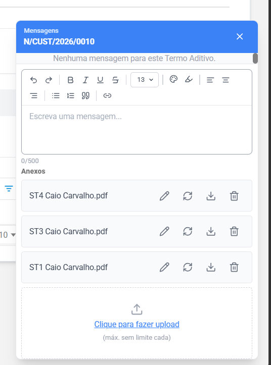
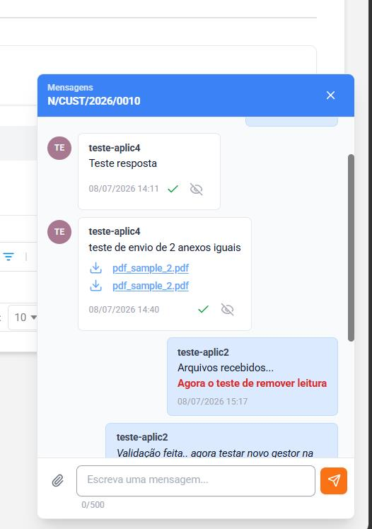
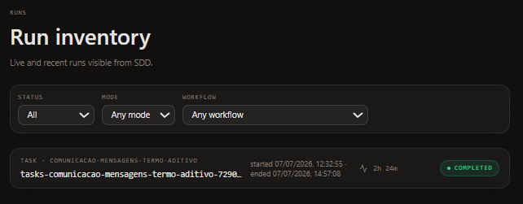
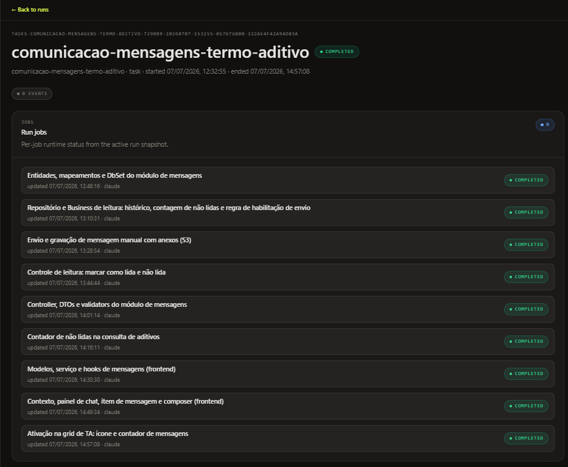

## O resultado {#resultado}

> **24h vs 80h**
>
> \~3,3× mais rápido · 70% menos tempo de desenvolvimento
>
> 80h = *estimativa do dev* para o desenvolvimento manual\
>  24h = tempo real medido\
>  **+8h de setup "AI-ready"** ocorrem uma única vez por repositório e amortizam nas próximas features

## O que foi construído {#o-que}

Um canal de comunicação assíncrona (chat) dentro de um contrato: texto rico com anexos, contador de mensagens não lidas por linha da grid e controle de leitura (marcar como lida / não lida). Com ele, a negociação passa a fazer parte do registro auditável do contrato, sem depender de e-mail ou telefone.

Não havia tela de partida: a funcionalidade foi gerada do zero. À esquerda, a primeira versão saída da execução das tasks; à direita, o resultado após o refinamento.

|  |  |
|---|---|
| **Primeira geração:** o chat como saiu da execução das tasks, partindo do zero, sem tela anterior. | **Após o refinamento:** com 1 print e poucos ajustes, o resultado aceito pelo cliente (mensagens, avatares de iniciais e controle de leitura). |

## Prova de execução {#prova}

Não é uma promessa de slide: o run das tasks rodou sozinho no Compozy e concluiu com status **COMPLETED**.



*Execução autônoma no Compozy: o run das tasks concluiu em **2h24m**.*

- **Complexidade:** Moderada
- **Histórias:** 3 encadeadas · potencial até 7
- **Time:** 1 dev fullstack
- **Estimativa manual:** 80h, estimativa do dev

## Etapa 0: deixar o projeto "AI-ready" (8h, uma única vez) {#setup}

Custo pago uma vez por repositório; não se repete nas próximas features.

- **2h** reunião para entender o fluxo de funcionamento do SDD
- **4h** estudar e criar as *rules* base do front
- **1h** configurar o ambiente
- **1h** estudo e troca de informações

Este é o número de um projeto real que usou o SDD na prática. Serve de referência, não de regra. Boa parte dele veio de ser a **primeira experiência** do time com o SDD: as **2h** de reunião e a **1h** de estudo servem para entender o fluxo uma vez só. Além disso, as *rules* do backend já estavam criadas, então o esforço se concentrou nas *rules* base do front. Um dev que já domina o processo e parte de um projeto com as *rules* das duas camadas prontas concentraria o tempo só onde faltasse, e gastaria **menos que 8h** nesta etapa.

## As 24h de desenvolvimento, etapa a etapa {#jornada}

As horas medidas em cada etapa do fluxo SDD, com o retrabalho em laranja e a execução autônoma das tasks em azul.

| Etapa | Horas |
|---|---|
| Gerar escopo com as histórias do fluxo | 1h |
| Ler e revisar o fluxo (`feature.md`) | 1h |
| Gerar e avaliar os ADRs previstos | 1h |
| 🟠 Retrabalho por mau uso do conjunto de histórias | 2h |
| Revisar PRD, responder questões abertas, revisar rules | 2h |
| Revisar TechSpec | 2h |
| Gerar, revisar e corrigir as tasks (ajuste de rule) | 2h |
| 🔵 Execução das tasks (1ª versão front/back) | 3h |
| Revisar código gerado front/back | 4h |
| Ajustar decisões fora do padrão (evolução de rules) | 1h |
| Testar fluxos em tela e composição visual (90% certo) | 2h |
| 🟠 Corrigir bug (join faltando) + alinhamento visual | 1h |
| Revisar testes unitários e ajustar merges | 1h |
| Correções no Sonar (viram novas rules do back) | 1h |
| **Total** | **24h** |

O dev estimou o fluxo completo em **32h** e o desenvolvimento em **22 a 26h**. O desenvolvimento real levou **24h**.

> ⚡ **O run autônomo do Compozy**
>
> A etapa "Execução das tasks" corresponde ao run autônomo: as 9 tasks rodaram sozinhas em **2h24m**. Os 9 jobs concluíram em sequência, do modelo de dados ao ícone na grid.
>
> 
>
> *Os 9 jobs do run, todos **COMPLETED** (12:32 → 14:57).*

## Os 3 gates revisáveis: o coração do método {#gates}

O que deu segurança ao dev foi poder **revisar** cada gate antes de o código existir: PRD → TechSpec/Tasks → ADR. Cada gate é um artefato legível, versionado e aprovável. Abaixo, trechos **reais** dos artefatos desta feature.

> **Gate 1 · PRD**
>
> Requisitos e critérios de sucesso em linguagem de negócio. Trecho real de `_prd.md`:
>
> ```
> ## Success Metrics
>
> - 100% das mensagens gravadas ficam associadas a autor, perfil e data/hora de
>   envio e, quando lidas, a autor e data/hora de leitura.
> - Adoção: número (ou proporção) de negociações de Termos Aditivos ativas que
>   utilizam o canal de mensagens do sistema após o lançamento.
> - Nenhuma mensagem ou anexo enviado é perdido, editado indevidamente ou
>   excluído do histórico após o envio.
> - As mensagens automáticas existentes são exibidas corretamente no histórico
>   (fundo cinza, centralizado, sem controles de leitura).
> ```

> **Gate 2 · TechSpec / Task**
>
> Tradução técnica em tasks implementáveis. Trecho real de `task_03.md` (a task onde, na revisão, faltou citar um relacionamento; veja [Desafios reais](#desafios)):
>
> ```
> ---
> status: completed
> title: Envio e gravação de mensagem manual com anexos (S3)
> type: backend
> complexity: medium
> dependencies:
>   - task_02
> ---
>
> ## Overview
>
> Implementa a operação "Atualizar Mensagem do Contrato" no caminho manual
> (Automatica = "N"): grava a mensagem, faz upload dos anexos no S3 e os vincula
> em tb_arquivomensagem, além do download de anexo por URL pré-assinada.
> ```

> **Gate 3 · ADR**
>
> Decisões de arquitetura registradas e rastreáveis. Trecho real de `adr-006.md`:
>
> ```
> # ADR-006: Geração de mensagens automáticas e transição de status
> #          diferidas para fluxo posterior
>
> ## Status
> Accepted
>
> ## Decision
>
> Manter no escopo atual o fluxo de chat que consome mensagens: recuperação e
> exibição do histórico (incluindo a renderização de mensagens automáticas já
> existentes), envio e armazenamento de mensagens manuais, controle de leitura
> e contador de não lidas. Esta decisão substitui o ADR-003 e estreita o ADR-001.
> ```

## Desafios reais e como cada um virou evolução de rule {#desafios}

Nada de história cor-de-rosa: a feature teve armadilhas, e vale distinguir o que foi decisão nossa, o que foi limitação a contornar e o que virou *rule* melhor para o próximo time. As três primeiras são as mais didáticas.

### 1. Escopo esticado além do especificado · 2h de retrabalho

O próprio SDD reconheceu a ponte com histórias vizinhas e **perguntou** se queríamos completar o fluxo inteiro, mesmo com parte das informações ainda incompleta, e **recomendou limitar o escopo**. Optamos por seguir com o fluxo completo, e foi essa escolha que gerou o retrabalho. **A ferramenta não errou:** ela identificou o risco e devolveu a decisão para o time. **Lição:** agrupar histórias relacionadas numa funcionalidade completa rende muito. Mas, quando o SDD recomenda limitar o escopo, o time acata ou assume, de olhos abertos, o custo do retrabalho.

### 2. Má prática herdada de `Context` no front

O legado desabilitava uma validação do ESLint; as tasks tentaram replicar isso. Correção: seguir boas práticas, ajustar o arquivo legado e **evoluir as rules** para serem mais criteriosas.

### 3. Componente reaproveitável ignorado

Um componente com baixo grau de evolução não foi considerado. Correção: ajustar a task e reforçar a **rule de componentização**.

- **Desvios de padrão →** `MapToMensagemDto` em vez de `MapearParaMensagemDTO`; constante `TextoMensagemMaximoCaracteres` duplicada em 2 locais (deveria ir ao arquivo de constantes); comentários desnecessários.
- **Bug do join faltando na `task_03` →** faltou citar o relacionamento da tabela de mensagens junto ao de arquivos anexados. Uma revisão mais atenta da task teria evitado o bug.
- **Chat visualmente diferente do esperado →** faltou detalhamento na descrição; com 1 print e poucos ajustes, o chat chegou ao resultado aceito pelo cliente.
- **Achados do Sonar viram rules de back →** `GeneratedRegexAttribute` (regex em compile-time); `static readonly` em vez de arrays constantes passados repetidamente.

> **Lição transversal:** as *rules* são o ativo que se acumula de uma feature para a outra. Quase todo desafio desta feature deixou o próximo time mais rápido.

## Veredito de quem usou {#veredito}

> - Achou o SDD **simples**; o passo a passo é funcional.
> - Sentiu **mais segurança** por revisar os **gates** (PRD, TechSpec, Tasks): é muito mais simples do que usar IA como "agente" solto pelo chat.
> - **Unificou front + back num só dev** (antes: front por um, back por outro, depois integração). Conduzindo a feature inteira de ponta a ponta, o dev passou a **entender o projeto com mais profundidade** do que quando o trabalho era fatiado entre pessoas, e ainda sobrou **mais tempo para testar os fluxos**.

> **Sobre o receio de "perder o conhecimento do projeto":** aqui aconteceu o oposto. Revisar cada gate (PRD, TechSpec, Tasks) obriga o dev a entender e aprovar o que será feito *antes* de o código existir; e conduzir a feature completa, front e back, dá a ele a visão de ponta a ponta que a divisão de tarefas costumava fragmentar. A IA acelera a escrita do código; a **decisão, a revisão e o entendimento continuam com o dev**, que sai da feature sabendo mais, não menos.

## Como o seu time adota {#adotar}

1. Deixe o projeto **AI-ready** (rules base, ambiente). É custo único e se paga nas features seguintes.
2. Defina o escopo como **funcionalidade completa dentro do que está especificado**: nem fragmentado demais, nem esticado além do que se sabe. Se o SDD recomendar limitar, leve a sério.
3. Rode os **3 gates** e **revise cada um**. É ali que o retrabalho sai barato.
4. Revise o código com atenção aos pontos que falharam aqui: relacionamentos/joins nas tasks, reaproveitamento de componentes e padrões de nomenclatura.
5. Trate cada desafio como **evolução de rule**: o processo melhora a cada feature.

Quer ajuda para adotar? [Fale com o Pitang Labs](/manifesto#contato).
